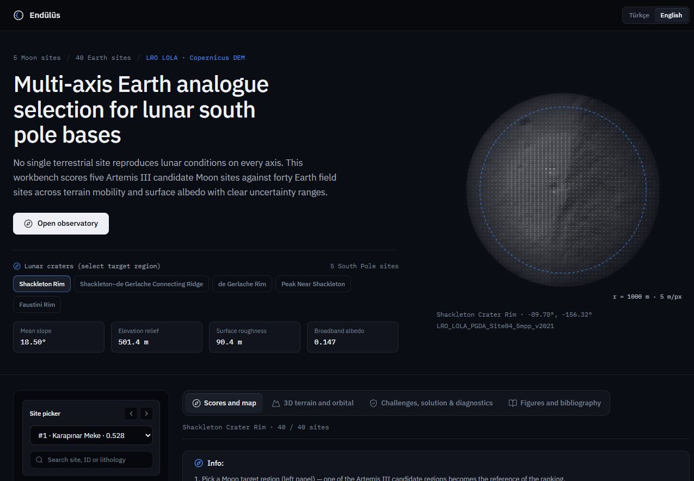
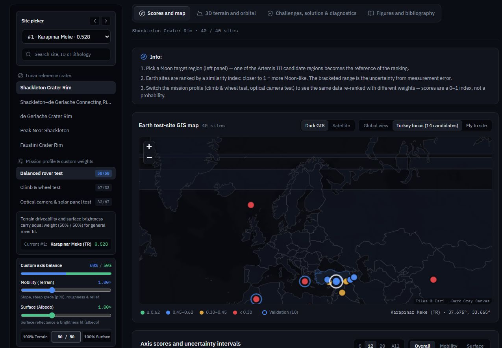
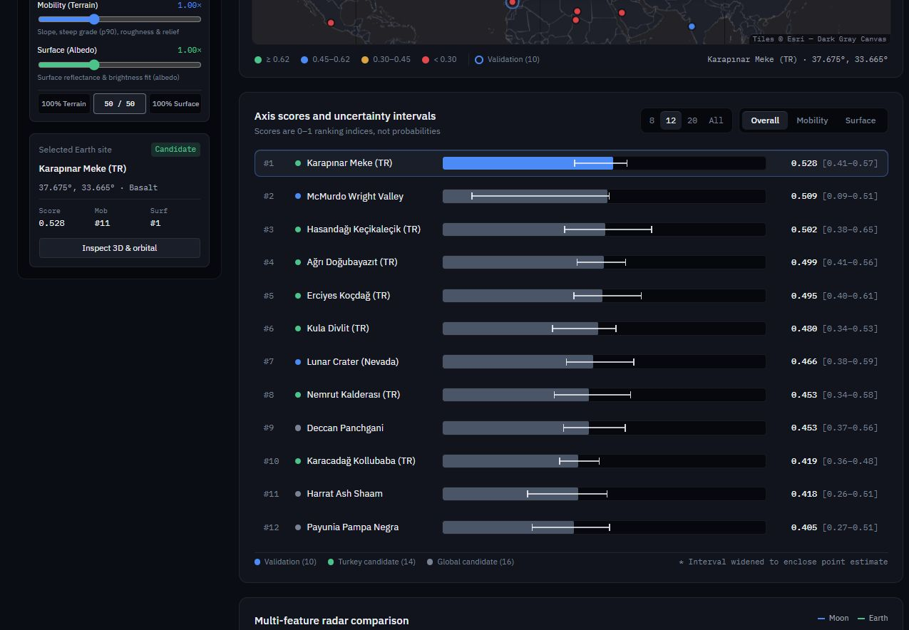
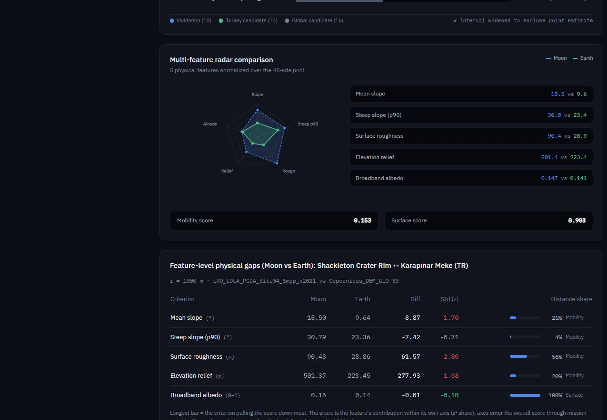
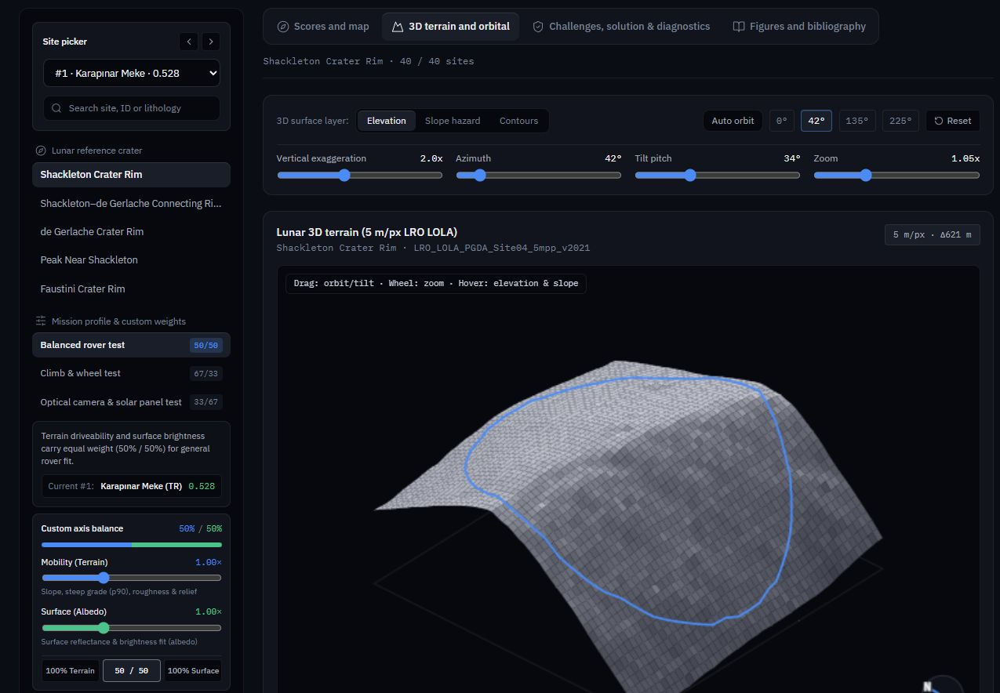
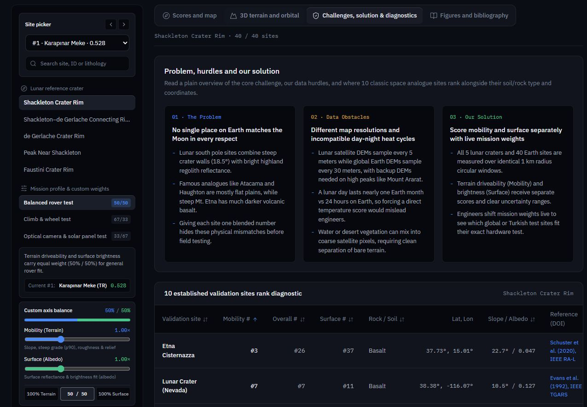

<div align="center">

# Endülüs — Moon ↔ Earth Analogue Conditions Observatory

**Which Earth sites can test hardware for a permanent lunar south pole base — on which axis, and how sure are we?**

[**Live app**](https://tilikumotp.github.io/endulus/) · [**Report (7-slide PDF)**](report/endulus_moon_analogue_scorer.pdf) · [**Data contract**](AGENTS.md#5-data-contract-do-not-deviate) · [**Data sources**](docs/data_sources.md)

[](https://tilikumotp.github.io/endulus/)

<sub>NASA Space Apps Challenge 2026 · "Permanent Moon Base Locations and Mars"</sub>

</div>

---

## The problem

No single place on Earth matches a Moon base site in every respect. Ranking Earth analogues with one blended "similarity score" hides exactly what mission planners need: *which* property matches, how much it is trusted, and where the analogy fails outright.

So we score **per axis**, attach **uncertainty** to every score, state **where the analogy breaks down**, map each axis to a concrete **equipment test**, and let the user re-weight the axes for a specific mission.

| | |
|---|---|
| **Reference body (v1)** | Lunar south pole — 5 Artemis III candidate regions, `Shackleton rim` first |
| **Earth sites** | 40 curated sites: 10 literature-documented analogues used as a rank diagnostic, 14 Turkish candidates, 16 global candidates |
| **Axes scored** | **Mobility** (mean slope, p90 slope, roughness, relief) · **Surface** (broadband albedo) |
| **Deliberately not scored** | Thermal — lunar Diviner polar temperatures and Earth MODIS day–night differences are not equivalent definitions, so v1 keeps them as context, not as a number |
| **Every value carries** | `_sd` (1σ uncertainty), `_src` (dataset + version), `_res_m` (native resolution) |

> Candidates (including Turkish sites) are presented as **candidates, never as confirmed analogues**.

## What the app does

1. **Pick a Moon reference region** — the ranking re-computes for that terrain.
2. **See ranked Earth sites on a GIS map** with a per-axis score and a Monte Carlo uncertainty band per site.
3. **Compare profiles** — radar chart plus a feature-level gap table showing *which* criterion pulls a score down and how much of the distance it explains.
4. **Re-weight for a mission** — balanced rover test (50/50), climb & wheel test (67/33), optical camera & solar panel test (33/67) — same data, different priorities.
5. **Read the honest part** — a card per site stating where the analogy breaks down, and a diagnostics table of the 10 established analogues with rock/soil type, coordinates and DOI.
6. **Inspect the terrain** — 3D DEM viewer built from the same 5 m/px LRO LOLA tiles, with slope-hazard overlay.

## Screenshots

| Map: ranked Earth sites | Axis scores with uncertainty |
|---|---|
| [](docs/screenshots/02-map.jpg) | [](docs/screenshots/03-axis-scores.jpg) |
| 40 sites, size/colour = score, hollow ring = validation site | Scores are 0–1 ranking indexes, not probabilities; brackets are P5–P95 Monte Carlo intervals |

| Radar + feature gaps | 3D terrain & orbital context |
|---|---|
| [](docs/screenshots/04-radar.jpg) | [](docs/screenshots/05-3d-terrain.jpg) |
| Moon vs Earth per criterion, with each criterion's share of the distance | LRO LOLA 5 m/px DEM, 2× vertical exaggeration, orbit/tilt/zoom |

| Problem, data obstacles, and the solution | Validation sites with cited literature |
|---|---|
| [](docs/screenshots/06-diagnostics.jpg) | same tab, below: 10 established analogues, their ranks, lithology and DOI |

## How the method works

1. **Same definitions on both bodies.** Inside an identical `1 km` analysis radius and in a projected metric CRS (polar stereographic for the Moon, local UTM/UPS for Earth): mean slope, p90 slope, roughness (std of detrended elevation), relief, broadband albedo.
2. **Moon reference.** NASA LRO LOLA PGDA 5 m/px DEMs and error maps (Barker et al., 2021) plus LOLA 1064 nm albedo scaled to broadband (scaling factor shown, with a sensitivity analysis).
3. **Earth features.** ESA Copernicus DEM GLO-30 (NASADEM fallback for one tile) for terrain, NASA MODIS MCD43A3 for albedo, ESA Sentinel-2 L2A for visual context.
4. **Scoring with uncertainty.** Features are standardised; per-axis similarity is `exp(-D)` of the standardised distance; 200 Monte Carlo draws from each feature's uncertainty give a 5–95 % interval per score.
5. **Mission re-weighting.** Weights redistribute between axes; the underlying measurements never change.
6. **Rank diagnostic, not holdout validation.** Run role-blind, the method recovers the well-known analogues *on the axes they are known for* — Mount Etna `#3/40` and Meteor Crater `#8/40` on mobility, McMurdo Dry Valleys `#2/40` on surface for the Shackleton rim. Since all sites share the same standardisation, we report this as a descriptive diagnostic and say so explicitly.

## What we found at Shackleton Rim (`r = 1000 m`, balanced profile)

Shackleton Rim versus the top-ranked site, `Karapınar Meke (TR)` — the table the app shows under the radar chart:

| Criterion | Moon | Karapınar (TR) | Earth − Moon | Share of distance |
|---|---:|---:|---:|---|
| Mean slope | 18.50° | 9.64° | −8.87° | 21 % Mobility |
| Steep slope (p90) | 30.79° | 23.36° | −7.42° | 4 % Mobility |
| Surface roughness | 90.43 m | 28.86 m | −61.57 m | 56 % Mobility |
| Elevation relief | 501.37 m | 223.45 m | −277.93 m | 20 % Mobility |
| Broadband albedo | 0.15 | 0.14 | −0.01 | 100 % Surface |

- **#1 balanced — Karapınar Meke (TR)** `0.528` `[0.41–0.57]`: surface `#1` (`0.903`), mobility `#11`.
- **#2 — McMurdo Wright Valley** `0.509` · **#3 — Hasandağı Keçekalecik (TR)** `0.502`, mobility `#1` (`0.335`).
- **Reweighting changes the answer:** at 2× mobility weight Hasandağı rises `#3 → #1` and Etna Cisternazza `#26 → #17` — same measurements, different mission priorities.
- **This is the point of the tool:** no site wins everywhere, and roughness — not slope — dominates the mobility distance at Shackleton.

## Where the analogy breaks down

These are shown to the user next to every score, because no Earth campaign can test them:

| Limit | Moon south pole | Earth |
|---|---|---|
| Gravity | ≈ 1.62 m/s² (1/6 g) | 9.81 m/s² |
| Atmosphere | Vacuum | 101 kPa, weather, wind |
| Radiation | Unshielded GCR + SEP | Shielded by atmosphere/magnetosphere |
| Day–night cycle | 29.5 Earth days | 24 h |
| Regolith | Angular, electrostatically charged, no organics | Soil/rock with water and biology |
| Data resolution | 5 m/px terrain | 30 m/px terrain (GLO-30) |

## Data

| Product | Used for | Native resolution |
|---|---|---|
| NASA LRO LOLA PGDA Product 78 (v2021) + error maps | Lunar slope, roughness, relief | 5 m/px |
| NASA LRO LOLA GDR LDAM 1064 nm albedo | Lunar broadband albedo | 1 km |
| ESA Copernicus DEM GLO-30 | Earth terrain (39 of 40 sites) | 30 m |
| NASADEM_HGT v001 | Earth terrain fallback (1 tile) | 30 m |
| NASA MODIS MCD43A3 v061 | Earth broadband albedo | 500 m |
| NASA MODIS MOD11A2 v061 | Earth land-surface temperature (context only) | 1 km |
| ESA Sentinel-2 L2A · ESA WorldCover v200 | Visual context, mixed-pixel check | 10 m |

Coarse products are never presented as resolving a 1 km site; the mismatch is recorded in `*_res_m`. Full provenance and DOIs: [`docs/data_sources.md`](docs/data_sources.md), [`docs/data_sources_moon.md`](docs/data_sources_moon.md), [`docs/data_sources_earth.md`](docs/data_sources_earth.md) (team-internal, Turkish).

## Repository layout

```
data/processed/      committed feature parquets — the data contract
                     features_moon.parquet · features_earth.parquet
data/raw/            orbital downloads (gitignored, never committed)
src/moon_mars/       lunar feature extraction, albedo sensitivity, visual atlas
src/earth/           Earth feature extraction, candidate curation, 3D grids
src/scoring/         similarity, uncertainty propagation, portfolio, validation
app/                 Streamlit application
web/                 React + Vite observatory (Leaflet GIS + 3D DEM), deployed to Pages
report/              submitted report PDF, publication figures, deck sources
docs/                data notes, source tables, validation expectations, screenshots
scripts/             contract validation and audit utilities
tests/               scoring, portfolio, validation and app smoke tests
```

## Run it locally

```bash
python -m venv .venv
.venv\Scripts\activate            # bash: source .venv/bin/activate
pip install -r requirements.txt

streamlit run app/main.py         # Streamlit app
```

The web observatory needs Node.js 18+ (the committed assets under `web/public/` are already generated):

```bash
cd web
npm install
npm run dev                       # http://127.0.0.1:5173
npm run build && npm run preview   # production build check
```

Regenerate the static JSON/figure assets from `data/processed/`:

```bash
python web/scripts/export_web_data.py
```

## Validation and tests

```bash
python scripts/validate_all.py --fail-on-mock
pytest                            # 51 tests: similarity, portfolio, validation, app smoke
```

`--fail-on-mock` rejects any committed parquet carrying a synthetic row, a `MOCK` source or a placeholder number: every committed value must come from a documented orbital product with its `_src`, `_sd` and `_res_m`. Current state: `2 files, 0 errors, 0 warnings`.

## Use of AI tools (SI acknowledgment)

AI coding assistants were used to accelerate writing and refactoring code, documentation and text translation, under the direction of the team. The research idea, methodology, site selection, scoring decisions and validation were designed and verified by the team. Every number in this repository comes from documented orbital data products (`*_src` columns); no AI-generated data, coordinates or citations are used, and no AI-generated images, video or audio appear in the project. All generated code was reviewed and passes the data-contract validation (`scripts/validate_contract.py --fail-on-mock`) and `pytest`.

<sub>Team rules, data contract and folder ownership: [AGENTS.md](AGENTS.md).</sub>
