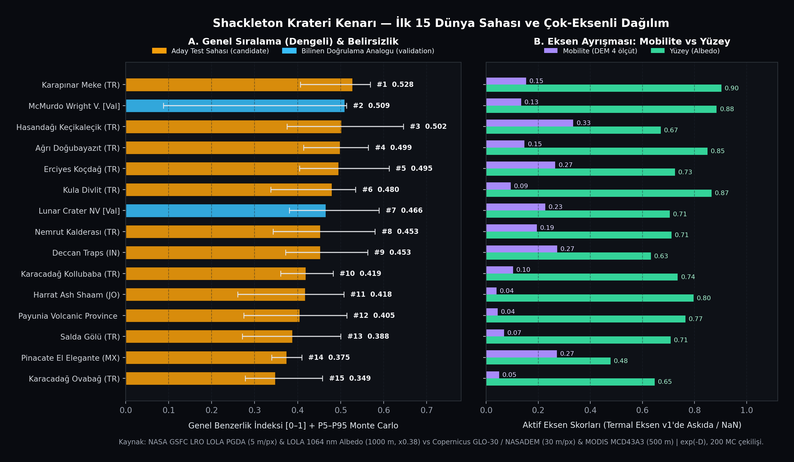
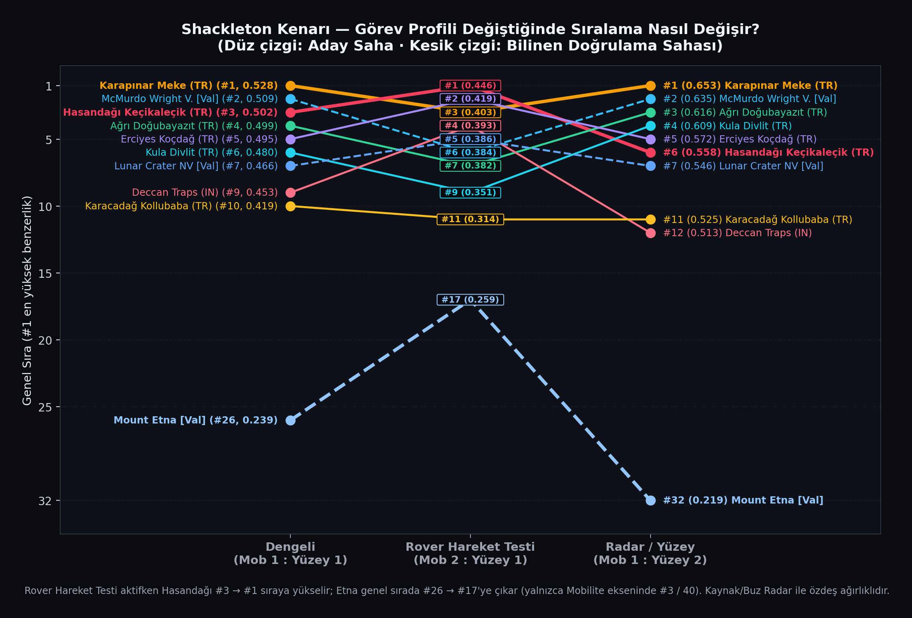
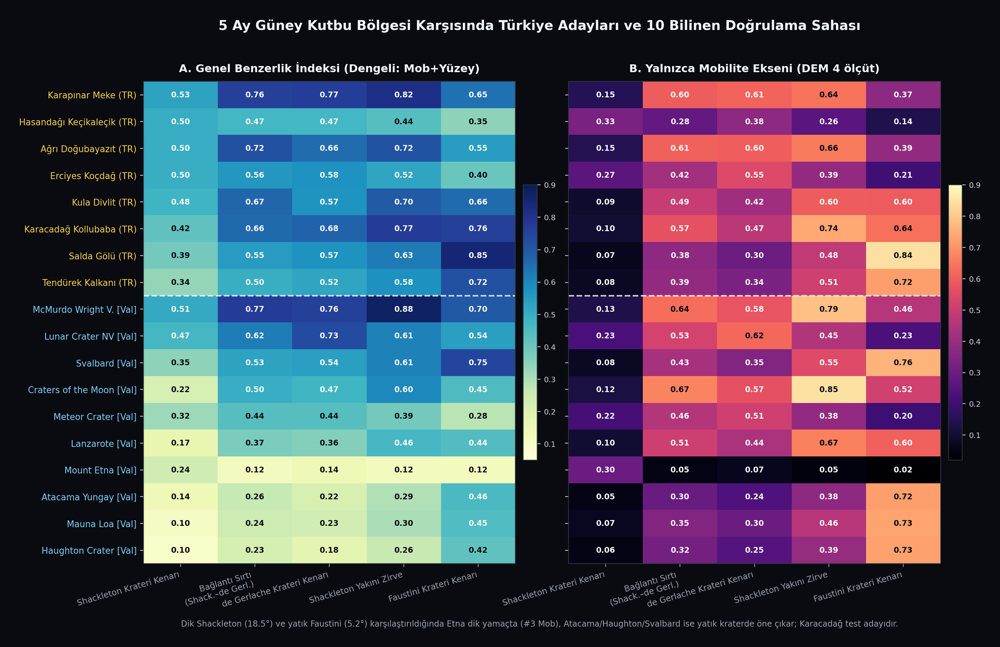
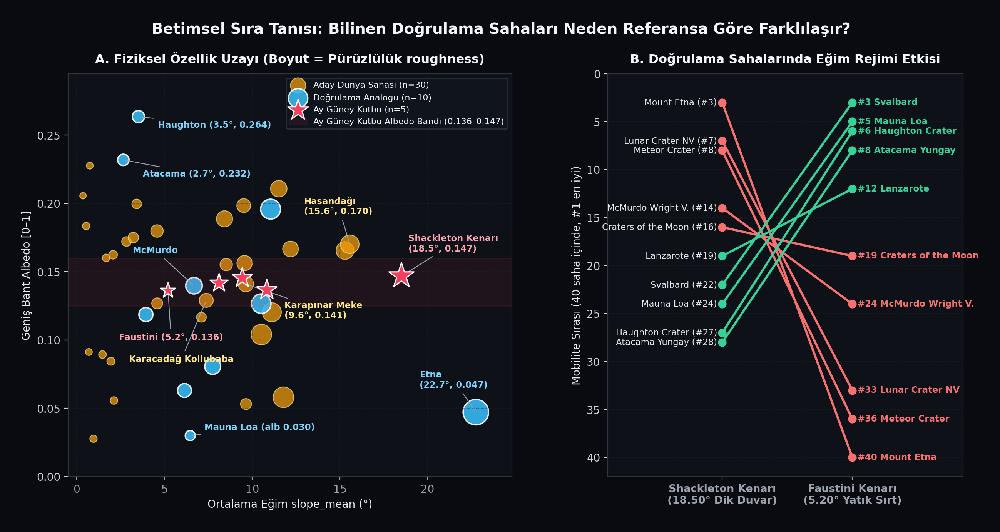
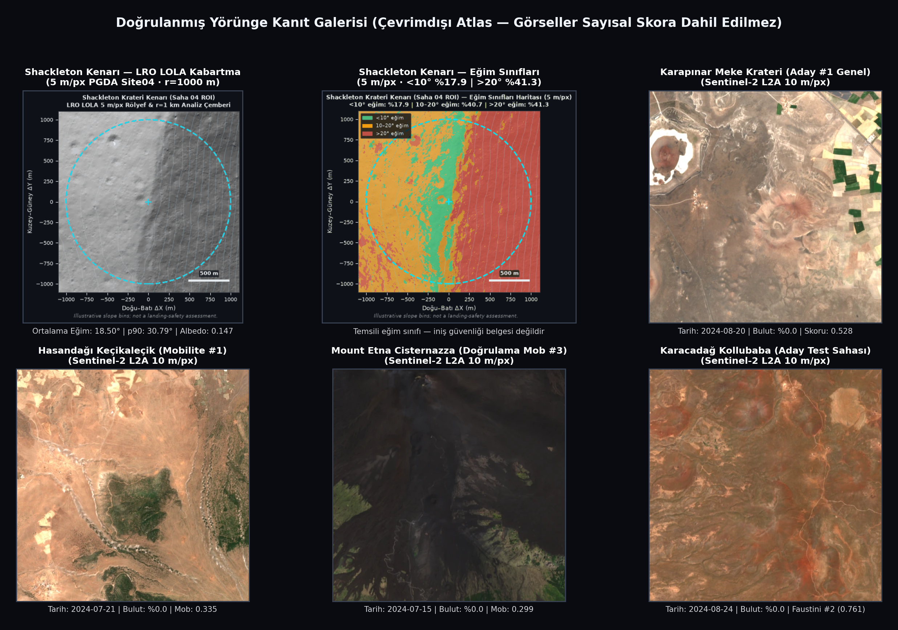

# Kalıcı Ay Üssü Aday Bölgeleri İçin Çok-Eksenli Dünya Analogu Seçimi, Belirsizlik Analizi ve Fiziksel Sınırlar (NASA Space Apps 2026)

**Proje Deposu:** [`AGENTS.md`](../AGENTS.md) · **Ana Kaynakça Dizini:** [`docs/data_sources.md`](../docs/data_sources.md) · **Uygulama:** [`app/main.py`](../app/main.py)  
**Veri Bütünlüğü Durumu:** `40` Dünya + `5` Ay Güney Kutbu sahası · `0 MOCK`, `0 hata`, `0 uyarı` (`scripts/validate_all.py --fail-on-mock`)

---

## 1. Yönetici Özeti ve Bilimsel Problem Tanımı

Hiçbir Dünya sahası Ay Güney Kutbu veya Mars koşullarını bütün fiziksel boyutlarıyla tek başına taklit edemez. Görev planlayıcıları "Ay için en iyi tek Dünya analogu hangisidir?" sorusuna tek bir birleştirilmiş puanla yanıt aradığında, bir sahanın güçlü olduğu özellik (örneğin dik krater duvarı pürüzlülüğü) başka bir özelliğin uyumsuzluğunu (örneğin bazaltik yüzey albedosu) gizler; üstelik yerçekimi ($1.62\text{ m/s}^2$), vakum, iyonlaştırıcı radyasyon ve `29.53` günlük kutup aydınlanma döngüsü gibi hiçbir Dünya arazisinde doğal olarak yeniden üretilemeyen fiziksel sınırlar gözden kaçırılır.

Bu çalışmada söz konusu "tek-skor tuzağını" çözmek amacıyla uçtan uca doğrulanmış yörünge/uydu verisine dayalı bir karar-destek çerçevesi geliştirilmiştir:

1. **Eksen Bazlı Nicel Skorlama (`src/scoring/similarity.py`):** Aday Dünya sahaları tek bir genel sıralamaya hapsedilmez; **Mobilite** (`slope_mean`, `slope_p90`, `roughness`, `relief`) ve **Yüzey** (`albedo`) aktif sayısal eksenlerinde ayrı ayrı `[0, 1]` aralığında puanlanır (`exp(-D)`).
2. **Termal Dürüstlük Disiplini (`Karar #30`):** Ay Güney Kutbu (`LRO Diviner`) ile Dünya (`MODIS MOD11A2`) sıcaklık genliği ve termal atalet tanımları aynı fiziksel zaman rejimine oturmadığı için v1'de termal eksen zorlama varsayımlarla puanlanmamış, Ay tarafında bilinçli olarak `NaN` (askıda) bırakılmıştır.
3. **Belirsizlik Propagasyonu:** Her uydu metriği 1-sigma belirsizliği (`*_sd`), ürün kodu (`*_src`) ve doğal piksel çözünürlüğü (`*_res_m`) taşır; belirsizlikler `200` bağımsız Gauss Monte Carlo çekilişiyle `P5–P95` aralığına taşınır (`scoring.display.expanded_interval`).
4. **Görev Profiline Duyarlı Ağırlıklandırma:** Aynı `40` Dünya sahası, seçilen mühendislik testine göre (*Dengeli*, *Rover Hareket Testi*, *Kaynak / Buz Araştırması (v1'de buz verisi içermez)*, *Yeraltı Radar Kalibrasyonu*) yeniden sıralanır.
5. **Bilinen Analoglarla Betimsel Sıra Tanısı ve Aday Disiplini:** Literatürde bilinen `10` doğrulama sahası (Etna, Atacama, Haughton, Mauna Loa, McMurdo, Lanzarote, Meteor Crater, Craters of the Moon, Svalbard, Lunar Crater Nevada), skorlayıcıya rol etiketi verilmeden `30` küresel ve Anadolu aday sahasıyla (`14` Türkiye + `16` küresel) birlikte sıralanır ve önceden kayıtlı DOI beklentileriyle (`docs/validation_expectations.md`) kıyaslanır. **Karacadağ** gibi az çalışılmış sahalar hiçbir zaman "doğrulanmış analog" değil, **test adayı (`candidate`)** olarak raporlanır.
6. **Analojinin Sınırları ve Çevrimdışı Görsel Kanıt:** `8` boyutlu kapsam tablosu sahada test edilebilecek eksenlerle yalnızca laboratuvar/simülasyonda sınanabilecek koşulları ayırır; yerel `5 m/px` LRO LOLA kabartma/eğim haritaları, `10 m/px` Sentinel-2 L2A görüntüleri ve `3B DEM` yüzeyleri sıfır ağ bağımlılığıyla nitel bağlam sunar.

---

## 2. Kapsam, Veri Sözleşmesi ve Uydu Ürünleri Envanteri

Tüm veriler [`AGENTS.md`](../AGENTS.md) §5 veri sözleşmesine uygun iki özdeş `36` sütunlu Parquet tablosunda tutulmaktadır (`body`, `site_id`, `name`, `role`, `lat`, `lon`, `radius_m`, `7` özellik × `[değer, _sd, _src, _res_m]`, `lithology_class`). Analiz yarıçapı tüm sahalarda `radius_m = 1000.0 m` (`2 km` çaplı daire) olarak sabitlenmiştir; eğim ve pürüzlülük hesaplanmadan önce her saha yerel metrik projeksiyona (Ay için Güney Kutbu Stereografik `R = 1737.4 km`; Dünya için yerel UTM/UPS) aktarılmıştır.

### 2.1 Ay Güney Kutbu Referans Sahaları (`data/processed/features_moon.parquet` — `5` Bölge)

Artemis III aday bölgeleri dikkate alınarak seçilen `5` NASA GSFC PGDA ROI koordinatı ve gerçek `5 m/px` LOLA / `1000 m` geniş bant albedo ölçümleri aşağıdadır ([`docs/data_sources_moon.md`](../docs/data_sources_moon.md)):

| Uygulama Adı | `site_id` | Koordinat (`lat, lon`) | `slope_mean ± sd` (°) | `slope_p90 ± sd` (°) | `roughness ± sd` (m) | `relief ± sd` (m) | `albedo ± sd` | DEM Kaynağı (`5 m`) |
|---|---|---|---|---|---|---|---|---|
| **Shackleton Krateri Kenarı** | `moon_shackleton_rim` | `-89.7800, -156.3201` | `18.50 ± 1.51` | `30.79 ± 1.51` | `90.43 ± 0.39` | `501.4 ± 0.6` | `0.147 ± 0.004` | `LRO_LOLA_PGDA_Site04_5mpp_v2021` |
| **Bağlantı Sırtı (Shackleton–de Gerlache)** | `moon_connecting_ridge` | `-89.4624, -137.0871` | `9.43 ± 1.89` | `16.23 ± 1.89` | `42.47 ± 0.36` | `184.5 ± 0.5` | `0.145 ± 0.001` | `LRO_LOLA_PGDA_Site01_5mpp_v2021` |
| **de Gerlache Krateri Kenarı** | `moon_de_gerlache_rim` | `-88.6683, -68.3754` | `10.83 ± 1.72` | `18.81 ± 1.72` | `44.96 ± 0.37` | `250.4 ± 0.6` | `0.137 ± 0.001` | `LRO_LOLA_PGDA_Site11_5mpp_v2021` |
| **Shackleton Yakını Zirve** | `moon_shackleton_peak` | `-88.8063, +123.5451` | `8.11 ± 1.77` | `15.27 ± 1.77` | `32.33 ± 0.33` | `213.6 ± 0.5` | `0.142 ± 0.002` | `LRO_LOLA_PGDA_Site07_5mpp_v2021` |
| **Faustini Krateri Kenarı** | `moon_faustini_rim` | `-87.8897, +90.0000` | `5.20 ± 1.98` | `8.68 ± 1.98` | `12.29 ± 0.45` | `145.2 ± 0.7` | `0.136 ± 0.000` | `LRO_LOLA_PGDA_LM7_5mpp_v2021` |

* **Albedo Hizalama ve Hassasiyet Notu:** LRO LOLA aktif lazer reflektometresi sıfır faz açısında (`α = 0°`) monokromatik `1064 nm` normal albedo (`0.358–0.387`) ölçer (`LRO-L-LOLA-4-GDR-V1.0:LDAM_50S_1000M_V1.0_broadband_eq`, `1000 m`). Dünya `MODIS MCD43A3.061` geniş bant güneş albedosuyla aynı ölçeğe getirmek için uygulanan `×0.38` katsayısının (`0.136–0.147`) duyarlılığı [`src/moon_mars/albedo_sensitivity.py`](../src/moon_mars/albedo_sensitivity.py) ile test edilmiş; `$c \in [0.34, 0.42]$` aralığında tüm 5 Ay sahasında genel sıralama Spearman korelasyonunun **$\rho = 0.866\text{–}0.944$** düzeyinde kararlı kaldığı doğrulanmıştır (`docs/data_sources_moon.md` §5.1). Tekil tablo kaynağı eksikliği `TODO(verify)` ile işaretlidir.
* **Nitel Litoloji Etiketleri:** `features_moon.parquet` içindeki `lithology_class` (`regolith`, `anorthosite`, `impact_breccia`) sayısal skora katılmaz; saha-bazlı anortozit/breş eşlemesi `TODO(verify)` şeffaflığıyla korunmaktadır.

### 2.2 Dünya Sahaları ve Ürün Kalibrasyonu (`data/processed/features_earth.parquet` — `40` Saha)

* **Rol ve Litoloji Dağılımı:** `10` doğrulama (`validation`) + `30` aday (`candidate`: `14` Türkiye, `16` küresel). Litoloji sınıfları: `27` `basalt`, `6` `pyroclastic_tuff`, `4` `evaporite`, `2` `impact_breccia`, `1` `regolith_permafrost`.
* **DEM (`30 m/px`, 40/40 geçerli):** `39` sahada `Copernicus_DEM_GLO-30` (EGM2008, `sigma_z_rel = 1.0 m` — Airbus/ESA Handbook `GEO.2018-1988-2 §4.2`); AWS/Planetary Computer arşivinde bulunmayan `N39 E044` karosu (`earth_agri_dogubayazit_flow`) için otomatik `NASADEM_HGT_v001` (`EGM96`) yedeği devreye girmiştir. Eğim/pürüzlülük/rölyef yerel türev ve farklardan hesaplandığı için bölgesel EGM96–EGM2008 geoit farkı sonuçları bozmaz; yalnızca mutlak rakım kıyaslamasında datum farkı belgelenmiştir (`docs/data_sources_earth.md` §8).
* **Albedo (`500 m/px`, 40/40 geçerli):** `MCD43A3.061` (`Albedo_BSA_shortwave`, 2024 yaz penceresi; Güney yüksek enlem McMurdo için Oca–Şub 2024). Tüm değerler token-bağımsız `MCD43A4.061` + `Liang (2001)` + `NDSI < 0.40` kar maskesiyle çapraz doğrulanmıştır (`docs/data_sources_earth.md` §5.1).
* **Sıcaklık Genliği ve Termal Atalet:** Dünya tablosunda `MOD11A2.061_annual_mean` (2024 yıllık 24 kompozit, `1000 m`) kayıtlı olup `thermal_inertia` tüm sahalarda `NaN`'dır (`40/40`). Ay `temp_amplitude = NaN` olduğu için v1 skorlayıcı yalnızca `mobility` ve `surface` eksenlerini kullanır.
* **Karışık Piksel Denetimi (`docs/data_sources_earth.md` §7):** ESA WorldCover (`10 m`) ve Sentinel-2 L2A (`20 m`) denetiminde `5` saha (`earth_salda_terrace`, `earth_tuz_golu_south`, `earth_svalbard_bockfjorden`, `earth_suphan_south_apron`, `earth_meteor_crater_arizona`) su/bitki/tarım karışımı nedeniyle `MIXED_*` olarak belgelenmiştir (sözleşme 36 sütunlu yapıda tutulmuştur). Ayrıca Etna noktası Dünya kar örtüsü taraması sonrası en saf tefra noktası olan OSM Cisternazza kraterine (`37.7257, 15.0084`, `%99.4` çıplak tefra) taşınmıştır.

---

## 3. Eksen Bazlı Benzerlik, Belirsizlik Propagasyonu ve Görev Ağırlıkları

Matematiksel çekirdek [`src/scoring/similarity.py`](../src/scoring/similarity.py) içindedir (`app/main.py` kendi skorunu hesaplamaz):

1. **Havuz Z-Ölçeklemesi (`_pool_stats`):** Her özellik $f$ için tüm geçerli Dünya sahaları ($N=40$) ile seçili Ay referans satırı ($N=41$) birlikte alınarak popülasyon ortalaması $\mu_f$ ve standart sapması $\sigma_f$ (`ddof=0`) hesaplanır.
2. **Eksen Mesafesi ve Puanı (`_axis_scores`):** Bir $a$ eksenindeki geçerli özellikler kümesi $F_a$ (`mobility` için `4` özellik; `surface` için `1` özellik: `albedo`; `thermal` Ay'da `NaN` olduğundan pasif) üzerinde aday $c$ ile Ay referansı $r$ arasındaki kesilmemiş (*uncapped*) karekök ortalama standart fark hesaplanır:
   $$D_a(c, r) = \sqrt{\frac{1}{|F_a|} \sum_{f \in F_a} \left(\frac{x_{c,f} - x_{r,f}}{\sigma_f}\right)^2}, \qquad S_a(c, r) = \exp\bigl(-D_a(c, r)\bigr) \in (0, 1]$$
   Burada $S_a$ olasılık veya kalibre edilmiş fiziksel yeterlilik ölçütü değildir; Z-ölçekli havuza bağımlı sıralama indeksidir.
3. **Monte Carlo Belirsizlik Propagasyonu:** Hem adayın hem referansın ilgili özelliklerde geçerli `_sd` değeri varsa, `seed=0` ve `blake2b(axis, site_id)` tabanlı sıradan bağımsız deterministik üreteçlerle `n_boot = 200` adet bağımsız Gauss gürültü çekilişi ($\mathcal{N}(0, \sigma_{c,f}^2)$ ve $\mathcal{N}(0, \sigma_{r,f}^2)$) yapılır; sabit $(\mu_f, \sigma_f)$ ölçeklemesi altında `q05` (%5) ve `q95` (%95) yüzdelikleri raporlanır. Bilinmeyen belirsizlik asla `0` varsayılmaz; bir özellikte `_sd = NaN` ise nokta skoru korunur fakat aralık `NaN` bırakılır. Görüntüleme katmanında `expanded_interval` (`src/scoring/display.py`), nadiren nokta tahmininin `[q05, q95]` dışında kalması durumlarında kullanıcı yanlış yorumunu önlemek için yalnızca gösterilen aralığı nokta skora kadar genişletir ve `*` ile işaretler (örn. `earth_mcmurdo_wright_valley`, çünkü `albedo_sd = 0.0961` nedeniyle gürültü çekilişleri nokta değerinin iki yanına asimetrik dağılır).
4. **Görev Profili Ağırlıkları (`src/scoring/config.py`):** Aktif eksenler `combine_axes_with_uncertainty` ile ağırlıklı ortalama üzerinden birleştirilir (`thermal` ekseni Ay'da `NaN` olduğu için ağırlık toplamı yalnızca aktif `mobility` + `surface` üzerinden normalize edilir):
   - `default` (*Dengeli*): `mobility=1.0, surface=1.0`
   - `rover_mobility` (*Rover Hareket Testi*): `mobility=2.0, surface=1.0`
   - `isru_ice` (*Kaynak / Buz Araştırması (v1'de buz verisi içermez)*): `mobility=0.5, surface=1.0` *(fiilî ağırlık `thermal` askıda olduğundan Yüzey `2:1` baskın)*
   - `radar_calibration` (*Yeraltı Radar Kalibrasyonu*): `mobility=1.0, surface=2.0`

---

## 4. Nicel Bulgular: 5 Ay Bölgesi, Görev Duyarlılığı ve Öne Çıkan Adaylar

### 4.1 `Shackleton Krateri Kenarı` (`moon_shackleton_rim`) İçin İlk 10 Dünya Sahası (Dengeli Profil)

Shackleton Kenarı yüksek ortalama eğimi (`18.50°`), p90 dikliği (`30.79°`), pürüzlülüğü (`90.43 m`), `501.4 m` rölyefi ve `0.147` albedosu ile en zorlu referanstır:

| Genel Sıra | `site_id` | Rol | Genel Skor (`P5–P95`) | Mobilite Skoru (Sıra) | Yüzey Skoru (Sıra) | Litoloji |
|---:|---|---|---:|---:|---:|---|
| **1** | `earth_karapinar_meke` | `candidate` | **0.528** `[0.406–0.569]` | 0.153 (`#11`) | **0.903** (`#1`) | `basalt` |
| **2** | `earth_mcmurdo_wright_valley` | `validation` | **0.509** `[0.088–0.513]` | 0.134 (`#14`) | **0.885** (`#2`) | `regolith_permafrost` |
| **3** | `earth_hasandagi_kecekalecik` | `candidate` | **0.502** `[0.375–0.646]` | **0.335** (`#1`) | 0.670 (`#12`) | `basalt` |
| **4** | `earth_agri_dogubayazit_flow` | `candidate` | **0.499** `[0.414–0.564]` | 0.147 (`#12`) | **0.850** (`#4`) | `basalt` |
| **5** | `earth_erciyes_kojugedigi` | `candidate` | **0.495** `[0.405–0.613]` | 0.266 (`#6`) | 0.725 (`#8`) | `basalt` |
| **6** | `earth_kula_divlit` | `candidate` | **0.480** `[0.338–0.535]` | 0.094 (`#20`) | **0.866** (`#3`) | `basalt` |
| **7** | `earth_lunar_crater_nevada` | `validation` | **0.466** `[0.381–0.589]` | 0.227 (`#7`) | 0.705 (`#11`) | `basalt` |
| **8** | `earth_nemrut_caldera_flank` | `candidate` | **0.453** `[0.343–0.580]` | 0.194 (`#9`) | 0.711 (`#9`) | `pyroclastic_tuff` |
| **9** | `earth_deccan_mahabaleshwar` | `candidate` | **0.453** `[0.372–0.563]` | **0.272** (`#4`) | 0.633 (`#14`) | `basalt` |
| **10** | `earth_karacadag_summit` | `candidate` | **0.419** `[0.360–0.483]` | 0.103 (`#18`) | 0.736 (`#7`) | `basalt` |

*Not: `McMurdo` yüksek `albedo_sd = 0.0961` belirsizliği nedeniyle Yüzey ekseninde `P5 = 0.043`e kadar sarkan çok geniş bir aralık gösterir; bu nedenle Bağlantı Sırtı, de Gerlache, Shackleton Yakını Zirve ve Faustini referanslarında nokta tahmini ham `q95`i aştığında `expanded_interval` görüntülenen aralığı nokta tahmine eşitleyip `*` ile işaretler.*

**Görev Profili Duyarlılığı (`moon_shackleton_rim`):**
* **Dengeli (`default`):** `#1 Karapınar Meke (0.528)`, `#2 McMurdo (0.509)`, `#3 Hasandağı (0.502)`, `#4 Ağrı Doğubayazıt (0.499)`, `#5 Erciyes (0.495)`.
* **Rover Hareket Testi (`rover_mobility`):** Mobilite ağırlığı iki katına çıkınca **`#1 Hasandağı Keçikaleçik (0.446)`** zirveye çıkar; `#2 Erciyes (0.419)`, `#3 Karapınar Meke (0.403)`, `#4 Deccan Panchgani (0.393)`, `#5 Lunar Crater Nevada (0.386)`.
* **Kaynak / Buz (v1'de buz verisi içermez)** ve **Yeraltı Radar Kalibrasyonu** (`surface` 2× ağırlıklı): `#1 Karapınar Meke (0.653)`, `#2 McMurdo (0.635)`, `#3 Ağrı Doğubayazıt (0.616)`, `#4 Kula Divlit (0.609)`, `#5 Erciyes (0.572)`.

**Mobilite vs Yüzey Liderleri (`Shackleton`):** Yalnızca arazi geometrisine (Mobilite) bakıldığında `#1 Hasandağı (0.335)`, `#2 Parícutin (0.311)`, **`#3 Etna Cisternazza (0.299)`**, `#4 Deccan (0.272)` ve `#5 Pinacate (0.271)` öne çıkar. Yüzeyde ise `#1 Karapınar Meke (0.903)`, `#2 McMurdo (0.885)`, `#3 Kula Divlit (0.866)`, `#4 Ağrı Doğubayazıt (0.850)` ve `#5 Harrat Ash Shaam (0.796)` sıralanır.

### 4.2 Diğer 4 Ay Referans Bölgesi İçin Karşılaştırmalı Özet (Dengeli Profil)

| Ay Referansı | Top-3 Genel (Skor) | Mobilite `#1` (Skor) | Yüzey `#1` (Skor) | Çevrimdışı Portföy (`thr=0.70`, aktif 2 eksen) |
|---|---|---|---|---|
| **Bağlantı Sırtı** (`9.43°`, alb `0.145`) | `#1 McMurdo` (`0.771`), `#2 Karapınar Meke` (`0.762`), `#3 Ağrı Doğubayazıt` (`0.720`) | `Puna de Atacama` (`0.740`) | `Karapınar Meke` (`0.925`) | `karapinar_meke + puna_campo_piedra_pomez` *(tüm aktif eksenler kapandı)* |
| **de Gerlache Kenarı** (`10.83°`, alb `0.137`) | `#1 Karapınar Meke` (`0.770`), `#2 McMurdo` (`0.763`), `#3 Lunar Crater NV` (`0.732`) | `Kapadokya Kavak` (`0.681`) | `McMurdo` (`0.946`) | Yalnız `mcmurdo` *(mobilite `0.70` altı)* |
| **Shackleton Yakını Zirve** (`8.11°`, alb `0.142`) | `#1 McMurdo` (`0.877`), `#2 Karapınar Meke` (`0.815`), `#3 Karacadağ Kollubaba` (`0.773`) | **`Craters of the Moon`** (`0.848`) | `Karapınar Meke` (`0.988`) | Tek saha `mcmurdo` *(tüm aktif eksenler kapandı)* |
| **Faustini Kenarı** (`5.20°`, alb `0.136`) | `#1 Salda Gölü` (`0.847`), `#2 Karacadağ Kollubaba` (`0.761`), `#3 Svalbard` (`0.749`) | `Salda Gölü` (`0.843`) | `McMurdo` (`0.939`) | Tek saha `salda_terrace` *(tüm aktif eksenler kapandı)* |

*Not: Yukarıdaki portföy sütunu, çekirdek motor [`src/scoring/portfolio.py`](../src/scoring/portfolio.py) (`select_portfolio`, eşik `0.70` sezgisel indeks ayarıdır) tarafından hesaplanan kuramsal kapsamdır; arayüz sade tutulduğundan ayrı portföy kartı uygulamaya konmamıştır.*

---

## 5. Betimsel Sıra Tanısı, Fiziksel Ayrışma ve Türkiye Aday Vaka Analizi

### 5.1 Bilinen 10 Doğrulama Sahasının Rol-Bağımsız Sıra Davranışı

Skorlayıcı `role` sütununu asla görmez. Ancak `40` sahanın tamamı `Z`-ölçeklemesine katıldığı için doğrulama sekmesi **bağımsız bir holdout testi değil, betimsel sıra tanısıdır**. Ön-kayıtlı DOI literatürüne göre (`docs/validation_expectations.md`): `8` saha `mobility`, `McMurdo` `thermal_only` (v1'de askıda), `Svalbard` ise aktif sayısal eksenlerde `none` (`E8` nitel permafrost `var`) beklentisine sahiptir.

Shackleton Kenarı'nda bazı ünlü Dünya analoglarının genel sırada düşük görünmesinin **iki net fiziksel nedeni** vardır (`axis_gaps`):

1. **Referans Krater Geometrisi (Dik vs Düz Arazi):** Shackleton Kenarı `18.50°` ortalama eğim ve `501.4 m` rölyef taşır (`roughness = 90.43 m`). **Etna Cisternazza** `22.74°` eğim ve `86.00 m` pürüzlülükle (`z_diff = -0.201`) **Mobilite'de `#3 / 40` (`0.299`)** çıkar; fakat albedosu `0.047` (koyu Ay Maria bazaltı) olduğundan `0.147` parlaklıktaki Shackleton'la Yüzey'de ayrışır (`z_diff = -1.719`, Yüzey `#37 / 40`, genel `#26`). Buna karşılık **Atacama Yungay** (`slope_mean = 2.65°`, `roughness = 10.67 m`) ve **Haughton Krateri** (`slope_mean = 3.51°`, `relief = 68.9 m`) düz Mars/Arktik test sahalarıdır; Shackleton'da Mobilite `#28` ve `#27` olsalar da daha yatık **`Faustini Kenarı`** (`5.20°`, `roughness = 12.29 m`) seçildiğinde **Mobilite ekseninde Svalbard `#3 (0.759)`** *(genel `#3`, `0.749`)*, **Mauna Loa `#5 (0.733)`**, **Haughton `#6 (0.727)`** ve **Atacama `#8 (0.723)`** düzeyine yükselir.
2. **Albedoya Dayalı Highland–Mare Ayrımı:** Shackleton (`0.147`) koyu Ay denizleri (`mare`) yerine parlaklığa yakın Ay yaylası/kutbu regolith albedosu taşır; bu yüzden taze koyu bazaltlar (`Mauna Loa 0.030`, `Etna 0.047`, `Lanzarote 0.063`) Yüzey ekseninde alt sıralarda kalır.

### 5.2 Türkiye Sahaları Vaka İncelemesi (`14` Aday Saha)

| `site_id` | Litoloji | Eğim (°) / `p90` / Rölyef (m) | Albedo | Shackleton Genel (Mob / Yüzey) | Faustini Genel (Mob / Yüzey) | Literatür Statüsü (`docs/data_sources_earth.md` §3) |
|---|---|---|---|---|---|---|
| `earth_karapinar_meke` | `basalt` | `9.64° / 23.36° / 223.4 m` | `0.141` | **`#1` (0.528)** (`#11 / #1`) | `#7` (0.646) (`#30 / #2`) | Literatürde bilinen maar/skorya sahası |
| `earth_hasandagi_kecekalecik` | `basalt` | `15.56° / 30.42° / 448.6 m` | `0.170` | **`#3` (0.502)** (**`#1`** `/ #12`) | `#33` (0.348) (`#39 / #16`) | Volkanoloji literatürlü **test adayı** |
| `earth_agri_dogubayazit_flow` | `basalt` | `9.56° / 22.90° / 205.7 m` | `0.156` | **`#4` (0.499)** (`#12 / #4`) | `#13` (0.547) (`#29 / #10`) | Volkanoloji literatürlü **test adayı** (`NASADEM`) |
| `earth_erciyes_kojugedigi` | `basalt` | `15.29° / 22.25° / 356.7 m` | `0.166` | **`#5` (0.495)** (`#6 / #8`) | `#29` (0.405) (`#35 / #13`) | Volkanoloji literatürlü **test adayı** |
| `earth_kula_divlit` | `basalt` | `8.52° / 16.09° / 120.4 m` | `0.155` | `#6` (0.480) (`#20 / #3`) | `#6` (0.658) (`#13 / #8`) | Volkanoloji literatürlü **test adayı** |
| `earth_nemrut_caldera_flank` | `pyroclastic_tuff` | `12.18° / 18.70° / 401.7 m` | `0.167` | `#8` (0.453) (`#9 / #9`) | `#26` (0.435) (`#32 / #14`) | Volkanoloji literatürlü **test adayı** |
| `earth_karacadag_summit` | `basalt` | `7.38° / 14.18° / 168.3 m` | `0.129` | `#10` (0.419) (`#18 / #7`) | **`#2` (0.761)** (`#11 / #3`) | Az çalışılmış **nicel test adayı** (teyitli analog değil) |
| `earth_salda_terrace` | `evaporite` | `4.58° / 11.46° / 120.6 m` | `0.127` | `#13` (0.388) (`#25 / #10`) | **`#1` (0.847)** (**`#1`** `/ #4`) | Literatürde Jezero Mars analogu (`MIXED_CROP+VEG`) |
| `earth_karacadag_ovabag` | `basalt` | `2.83° / 5.27° / 77.4 m` | `0.172` | `#15` (0.349) (`#30 / #13`) | `#11` (0.609) (`#9 / #17`) | Volkanoloji literatürlü **test adayı** |
| `earth_tendurek_shield` | `basalt` | `7.11° / 11.36° / 204.8 m` | `0.117` | `#17` (0.337) (`#21 / #17`) | `#4` (0.719) (`#7 / #9`) | Volkanoloji literatürlü **test adayı** |
| `earth_acigol_guneydag` | `pyroclastic_tuff` | `3.22° / 7.09° / 106.2 m` | `0.175` | `#18` (0.337) (`#26 / #15`) | `#8` (0.643) (`#2 / #18`) | Literatürde bilinen maar/tefra sahası |
| `earth_suphan_south_apron` | `basalt` | `9.52° / 17.94° / 270.3 m` | `0.198` | `#23` (0.273) (`#13 / #23`) | `#30` (0.398) (`#26 / #27`) | **Test adayı** (`MIXED_CROP+VEG` step fenolojisi) |
| `earth_cappadocia_kavakkoy` | `pyroclastic_tuff` | `11.51° / 23.89° / 258.9 m` | `0.211` | `#25` (0.261) (`#10 / #29`) | `#37` (0.290) (`#31 / #31`) | Volkanoloji literatürlü **test adayı** |
| `earth_tuz_golu_south` | `evaporite` | `0.35° / 0.63° / 2.9 m` | `0.206` | `#31` (0.198) (`#40 / #27`) | `#32` (0.367) (`#28 / #29`) | Literatürde evaporit düzlüğü (`MIXED_WATER`) |

**Karacadağ Yorumu (`AGENTS.md` §1 & §6):** `Karacadağ Kollubaba` zirve platosu Shackleton'da `#10 (0.419)` düzeyinde kalırken daha yumuşak eğimli `Faustini`de `#2 (0.761)` ve `Shackleton Yakını Zirve`de `#3 (0.773)` konumuna çıkar. Ancak yüksek bir indeks saha ve laboratuvar doğrulaması yerine yalnızca nicel ön tarama hipotezi sunar — Karacadağ hiçbir bölümde "doğrulanmış Ay analogu" olarak ilan edilmemiştir. Benzer biçimde `Salda Gölü` (`MIXED_CROP+VEG`) jeokimyasal olarak karbonat/evaporit sahasıdır ve Faustini'deki topografik/albedo yakınlığı (`#1`) Dünya arazi karışım piksellerinden ve fiziksel benzerlikten arınmış ham ölçekten kaynaklanan bir test adayı sonucudur.

---

## 6. Analojinin Sınırları ve 8 Boyutlu Kapsam Çerçevesi

Uygulamadaki `Analojinin Sınırları` sekmesi 8 fiziksel boyutu açıkça ayırır:

1. **Topografya & Arazi (`Mobilite` — Aktif):** `5 m/px` Ay LOLA DEM vs `30 m/px` Dünya Copernicus/NASADEM karşılaştırması aynı `r = 1000 m` pencerede metrik eğimle yapılır; `6×` çözünürlük farkı gereği sonuçlar ölçek-bağımlı vekil göstergedir.
2. **Yüzey Parlaklığı (`Yüzey` — Aktif):** `1000 m` LOLA `1064 nm` (`×0.38`) vs `500 m` MODIS `MCD43A3` geniş bant albedo; piksel altı kaya/toz karışımını (`MIXED_*` sahaları) doğrudan çözemez.
3. **Sıcaklık Genliği & Termal Atalet (`Kullanılmıyor — v1 Askıda`):** LRO Diviner `240 m` verisi 29.53 günlük vakumlu kutup döngüsü verirken MODIS `1000 m` 24 saatlik atmosferli gündüz–gece farkı verir (`Karar #30`); termal atalette ortak küresel ürün yoktur.
4. **Yüzey Litolojisi (`Nitel — Skorsuz`):** `basalt`, `evaporite`, `pyroclastic_tuff`, `impact_breccia`, `regolith_permafrost`; mineral spektrumları sayısal skora sokulmaz.
5. **Su Buzu / PSR & Permafrost (`Nitel — Skorsuz`):** E8 envanterinde McMurdo/Haughton/Svalbard `var`, Etna `kısmi`, Atacama `yok`; kriyojenik vakum buzu laboratuvar kriyostatı gerektirir.
6. **Lav Tüpleri & Yeraltı Boşlukları (`Nitel — Skorsuz`):** v2'de RADARSAT-1 / Mini-RF radar entegrasyonu hedeflenir.
7. **Toz, Rüzgâr & Elektrostatik Toz (`Laboratuvar & Simülasyon`):** Elektrostatik yapışkan regolit yalnızca plazma/toz odalarında test edilebilir.
8. **Yerçekimi (`1/6 g`), Vakum, Radyasyon & 29.5 Günlük Döngü (`Laboratuvar & Simülasyon`):** Hiçbir Dünya arazisinde doğal olarak yeniden üretilemez.

---

## 7. İnteraktif Uygulama Mimarisi ve v2 Yol Haritası

[`app/main.py`](../app/main.py) Streamlit, Pydeck ve Plotly üzerinde tamamen Türkçe varsayılan (`+ İngilizce` geçişli), sıfır emojili, yüksek kontrastlı saf siyah (`#000000`) tek temalı arayüzle `6` sekme sunar:
1. **Harita:** `40` saha üzerinde mavi dış halka = bilinen `10` doğrulama sahası, kırmızı→yeşil dolgu = seçili görev puanı, zengin araç ipucu (`expanded_interval` + litoloji).
2. **Eksen Grafikleri:** Aktif `Mobilite` ve `Yüzey` çubuk grafikleri (`P5–P95` hata aralıkları); termal eksen askıda kalma bilgisiyle.
3. **3D Arazi:** Doğrulanmış gerçek `5 m/px` Ay (`moon_3d/`) ve `30 m/px` Dünya (`earth_3d_grids.npz`) yükseklik yüzeyleri, abartı ve kamera açısı kontrolüyle.
4. **Skor Tablosu:** Rol filtresi, `expanded_interval` destekli genel/eksen skorları, nitel litoloji ve kaynakça sütunu.
5. **Sıra Tanısı (Doğrulama):** Monoton tamsayı sıralamalı (`Mobilite Sırası`, `Genel Sıra`, `Yüzey Sırası`), E1 beklentili, E8 buz etiketli ve tıklanabilir DOI bağlantılı `10` doğrulama sahası tanı tablosu.
6. **Analojinin Sınırları:** `8` boyutlu kapsam scorecard'ı, aday seçici, çevrimdışı 3 panelli `5 m` LOLA + `10 m` Sentinel-2 L2A görsel bağlam inceleyicisi, özellik bazlı `z_diff` / `_src` / `_res_m` fark tablosu ve **daraltılabilir Veri Kaynakları ve Akademik Kaynakça (Ay & Dünya)** bölümü.

**v2 Yol Haritası:** (a) PDS Diviner `ltim01..96` tam günlük eğrileri ile eşdeğer termal tanımın kurulması, (b) RADARSAT-1 × Mini-RF SAR ile lav tüpü/radar ekseninin sayısallaştırılması, (c) MOLA/THEMIS/TES entegrasyonuyla `features_mars.parquet` üzerinde Mars referanslarının (`Jezero`, `Gale`) devreye alınması (`AGENTS.md` §5 şeması buna hazırdır).

---

## 8. Tam Kaynakça — Emirhan (`p2-moonmars`) & Eray (`p3-earth`)

### 8.1 Emirhan (`p2-moonmars`) — Ay Güney Kutbu Veri ve Literatür Kaynakları
* **Birincil NASA Ürünleri:** NASA GSFC PGDA Product 78 (`LRO_LOLA_PGDA_{Site04,Site01,Site11,Site07,LM7}_5mpp_v2021`, `5 m/px` DEM & `_slperr`/`_toterr` hata haritaları); `LRO-L-LOLA-4-GDR-V1.0:LDAM_50S_1000M_V1.0_broadband_eq` (`1000 m`, `×0.38` ölçekli); LRO Diviner `LRO-L-DLRE-5-PCP-V1.0` (`240 m`, v1'de `Karar #30` ile askıda).
* **Hakemli Makaleler (`docs/data_sources_moon.md`):** Barker et al. (2021, *Planet. Space Sci.* 203:105119, DOI `10.1016/j.pss.2020.105119`); Mazarico et al. (2011, *Icarus* 211(2):1066–1081); Zuber et al. (2012, *Nature* 486:378–381, DOI `10.1038/nature11216`); Spudis et al. (2008, *GRL* 35:L14201, DOI `10.1029/2008GL034468`); Lucey et al. (2014, *JGR Planets* 119(7):1665–1679, DOI `10.1002/2013JE004592`); Lemelin et al. (2016, *Icarus* 273:315–328, DOI `10.1016/j.icarus.2016.02.006`); Vasavada et al. (2012, *JGR* 117:E00H18, DOI `10.1029/2011JE003987`); Paige et al. (2010, *Science* 330:479–482); Williams et al. (2019, *JGR Planets* 124(10):2505–2521, DOI `10.1029/2019JE006028`); Hayne et al. (2017, *JGR Planets* 122(12):2371–2400, DOI `10.1002/2017JE005387`).

### 8.2 Eray (`p3-earth`) — Dünya Uydu Ürünleri, Doğrulama DOI'leri ve 40 Saha Kaynakçası
* **Birincil Uydu Ürünleri (`docs/data_sources_earth.md`):** `Copernicus_DEM_GLO-30` (`30 m`, EGM2008, `GEO.2018-1988-2`, `39` saha); `NASADEM_HGT_v001` (`30 m`, EGM96, DOI `10.5067/MEaSUREs/NASADEM/NASADEM_HGT.001`, Ağrı fallback); MODIS `MCD43A3.061` (`500 m`) + `MCD43A4.061` / Liang (2001, *Remote Sens. Environ.* 76:213–238); MODIS `MOD11A2.061_annual_mean` (`1000 m`); ESA WorldCover `v200` (`10 m`) & Sentinel-2 L2A (`20 m` / `10 m`).
* **Doğrulama Sahaları & E8 Buz Envanteri DOI'leri (`docs/validation_expectations.md`):** Schuster et al. (2020, DOI `10.1109/LRA.2020.3007468`); Vayugundla et al. (2018, ISR); Oliva et al. (2018, DOI `10.1016/j.earscirev.2018.06.018`); Wettergreen et al. (2005, DOI `10.1109/ROBOT.2005.1570227`); McKay et al. (2003, DOI `10.1089/153110703769016460`); Navarro-González et al. (2003, DOI `10.1126/science.1089143`); Lee & Osinski (2005, DOI `10.1111/j.1945-5100.2005.tb00144.x`); Osinski et al. (2005, DOI `10.1111/j.1945-5100.2005.tb00147.x`); Thomson et al. (2012, DOI `10.1029/2012JE004053`); Shiro et al. (2022, DOI `10.1016/j.pss.2021.105409`); Marchant & Head (2007, DOI `10.1016/j.icarus.2007.06.018`); Levy et al. (2008, DOI `10.1017/S0954102008001375`; 2010, DOI `10.1016/j.icarus.2009.09.005`); Sauro et al. (2020, DOI `10.1016/j.earscirev.2020.103288`; 2023, DOI `10.1016/j.actaastro.2022.12.034`); Kring (2007/2017, LPI 1355); Poelchau et al. (2009, DOI `10.1029/2008JE003235`); Kumar et al. (2010, DOI `10.1016/j.icarus.2010.03.032`); Shoemaker (1959, DOI `10.3133/ofr59108`); Hughes et al. (2019, DOI `10.1089/ast.2018.1847`); Lim et al. (2019, DOI `10.1089/ast.2018.1869`); Humlum et al. (2003, DOI `10.3402/polar.v22i2.6455`); Treiman (2012, DOI `10.3402/polar.v31i0.17320`); Evans et al. (1992, DOI `10.1109/36.134087`); Valentine et al. (2017, DOI `10.1130/GES01428.1`); Scott & Trask (1971, DOI `10.3133/pp599i`).
* **30 Aday Sahanın Koordinat & Jeoloji Kaynakları:** Tüm 14 Türkiye ve 16 küresel adayın tam künyesi [`docs/data_sources.md`](../docs/data_sources.md) §3.2, [`docs/data_sources_earth.md`](../docs/data_sources_earth.md) §4 ve uygulama içindeki *Veri Kaynakları ve Akademik Kaynakça* panelinde eksiksiz olarak sunulmaktadır.
