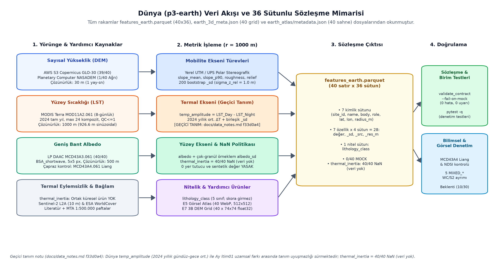
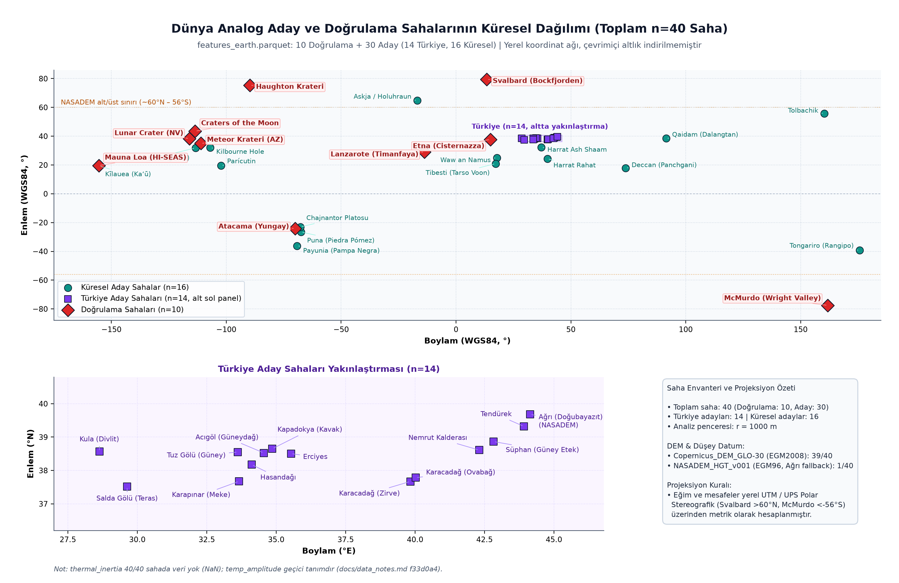
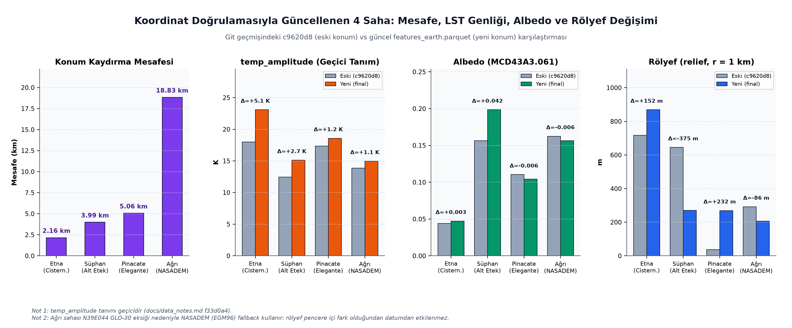
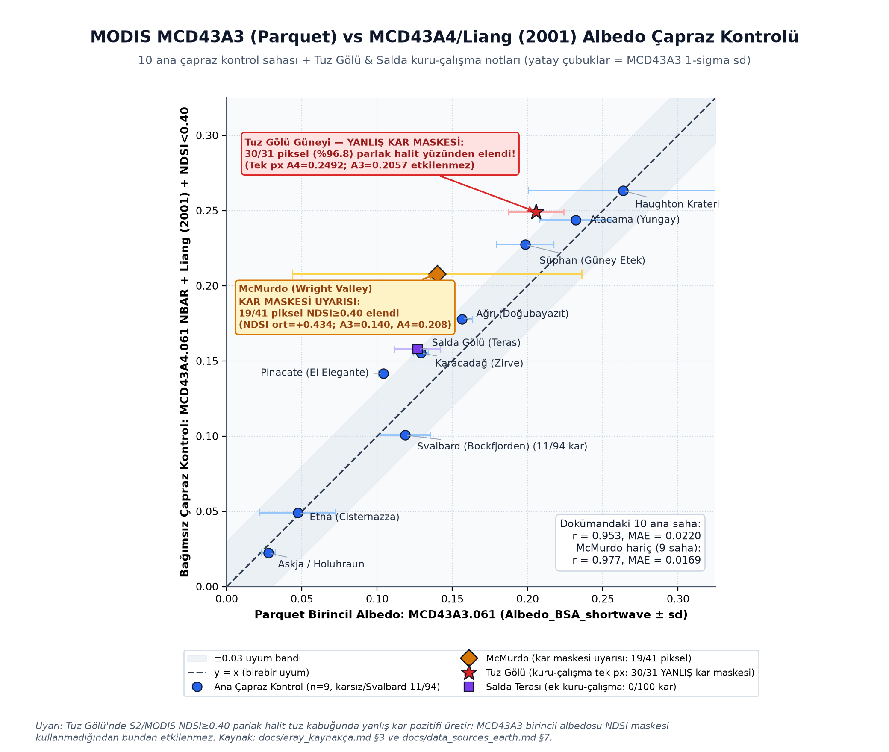
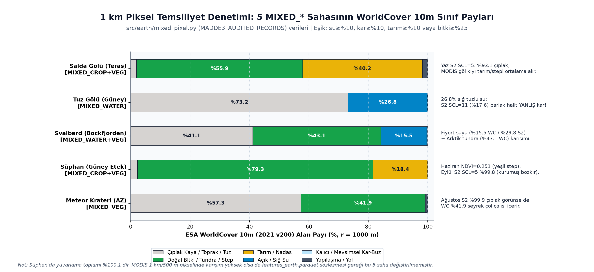
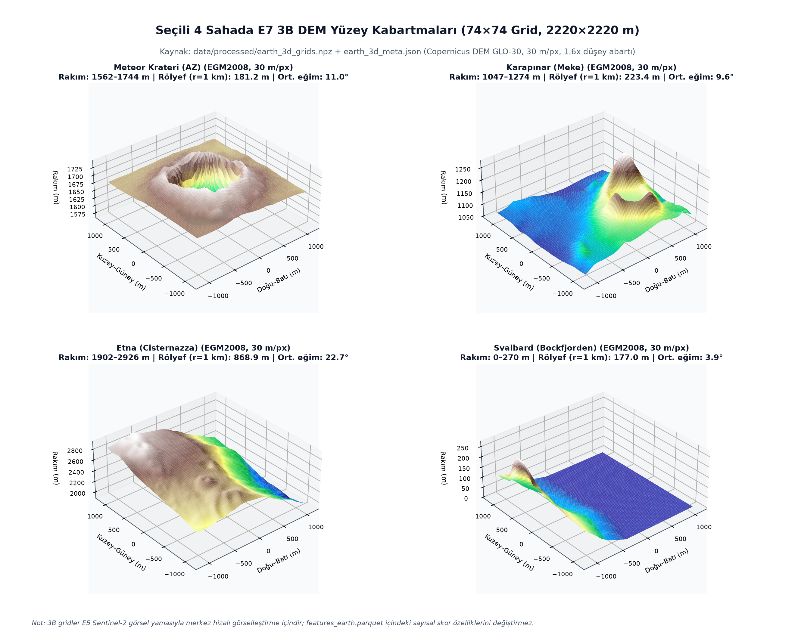
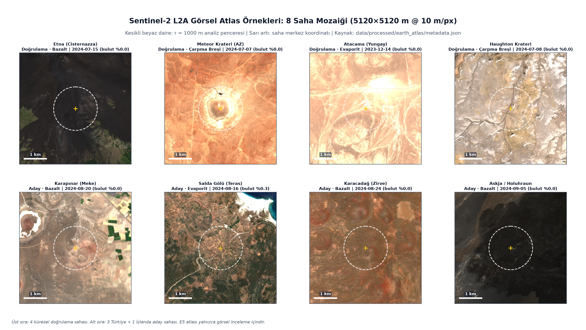
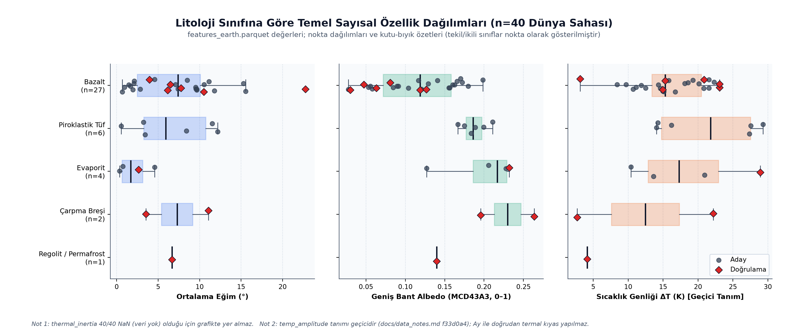
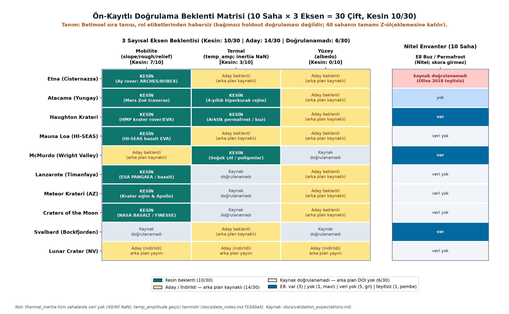

# ENDÜLÜS — Dünya (`p3-earth`) Veri Üretimi, Kalite Denetimleri ve Doğrulama Protokolü Raporu

**Proje:** NASA Space Apps 2026 — *Permanent Moon Base Locations and Mars* (ENDÜLÜS)  
**Dal / Kapsam:** `p3-earth` (`features_earth.parquet` v1 — 40 Saha × 36 Sözleşme Sütunu)  
**Tarih:** 2026-11-15  

---

## 1. Amaç ve Kapsam

Hiçbir Dünya sahası Ay Güney Kutbu'nu veya Mars yüzeyini her fiziksel eksende aynı anda temsil edemez[^agents]. ENDÜLÜS çerçevesinde Dünya iş paketi (`p3-earth`), aday ve doğrulama sahalarını **eksen bazlı** (`mobility`, `thermal`, `surface`) ölçütlerle sayısallaştırmayı, her özelliğe birincil belirsizlik (`*_sd`), veri kaynağı etiketi (`*_src`) ve doğal piksel çözünürlüğü (`*_res_m`) eklemeyi, piksel karışımı ile ölçek sınırlarını şeffaf biçimde raporlamayı amaçlar[^agents].

Bu raporun kapsadığı birincil veri ürünü `data/processed/features_earth.parquet`, **`40` satır (`10` `validation` + `30` `candidate` [14 Türkiye, 16 küresel]) × `36` sözleşme sütunu** içerir (`29.376` bayt; `0/40 MOCK`)[^parquet][^ek]. Sözleşme yapısı `AGENTS.md §5` gereği **7 kimlik sütunu** (`site_id`, `name`, `body`, `role`, `lat`, `lon`, `radius_m = 1000.0 m`), **7 sayısal özellik × 4 alt sütun = 28 sütun** (`slope_mean`, `slope_p90`, `roughness`, `relief`, `temp_amplitude`, `thermal_inertia`, `albedo` için değer, `*_sd`, `*_src`, `*_res_m`) ve skora girmeyen **1 niteliksel sütundan** (`lithology_class`) oluşur[^agents][^dse].

`AGENTS.md §7` uyarınca Türkiye'den seçilen `14` aday saha[^dse], uluslararası literatürde halihazırda Mars/Ay analogu olarak bilinen havzalar (`earth_salda_terrace`, `earth_tuz_golu_south`, `earth_acigol_guneydag`, `earth_karapinar_meke`) ile yerbilimleri/petroloji yayınlarından alınan nicel test adayları (*Karacadağ Zirve & Ovabağ*, *Kula*, *Tendürek*, *Erciyes*, *Hasandağı*, *Kapadokya*, *Süphan*, *Nemrut*, *Ağrı*) olarak ikiye ayrılır[^dse]. Hiçbir aday saha kesinleşmiş veya kanıtlanmış Ay/Mars eşdeğeri olarak sunulmaz[^agents].

---

## 2. Veri ve Yöntem

Tüm sayısal özellikler sentetik veya `0` yer tutucu değer üretilmeksizin AWS Open Data, Microsoft Planetary Computer STAC ve NASA LP DAAC Earthdata Cloud arşivlerinden `radius_m = 1000.0 m` yarıçaplı analiz penceresiyle çekilmiştir[^ek][^dse]. Veri akışı Şekil 2'de özetlenmiştir.

*Şekil 2. Ham yörünge kaynaklarından 36 sütunlu `features_earth.parquet` çıktısına veri işleme, belirsizlik yayılımı ve denetim kapıları (`features_earth.parquet`, `earth_3d_meta.json`, `earth_atlas/metadata.json`).*[^parquet][^m3d][^atlas]

### 2.1 Topoğrafya (`Copernicus_DEM_GLO-30` ve Ağrı `NASADEM_HGT_v001` Yedeği)

- **Birincil DEM (`39/40` saha):** AWS Open Data / Planetary Computer üzerinden `30.0 m` (`1 arc-second`) çözünürlüklü **`Copernicus_DEM_GLO-30`** (DGED, **EGM2008** `EPSG:3855` ortometrik datum) kullanılmıştır[^dse][^m3d]. Bağıl düşey belirsizlik `sigma_z_rel = 1.0 m` (`LE90 < 2.0 m` ürün spesifikasyonu) değerine dayalıdır[^dse][^dn].
- **Ağrı Yedeği (`1/40` saha — `NASADEM_HGT_v001`):** `earth_agri_dogubayazit_flow` sahasını kapsayan `N39 E044` karesi Copernicus GLO-30 arşivinde bulunmadığı (`HTTP 404`) için Planetary Computer / NASA MEaSUREs **`NASADEM_HGT_v001`** (`30.0 m`, **EGM96** geoit datumu; `10.5067/MEaSUREs/NASADEM/NASADEM_HGT.001`) otomatik fallback olarak uygulanmıştır[^dse][^ek].
- **EGM96 vs EGM2008 Notu:** Ağrı (`NASADEM`, `EGM96`) ile diğer 39 saha (`GLO-30`, `EGM2008`) arasında metre ölçeğinde sabit bölgesel geoit ofseti bulunabileceğinden mutlak rakımlar (`elev_min_m`–`elev_max_m`) doğrudan kıyaslanmamalıdır; buna karşılık `r = 1000.0 m` penceresi içindeki eğim, düzlem kalıntısı (`roughness`) ve göreceli rölyef (`relief = max − min`) türev/fark büyüklükleri yavaş değişen bu ofsetten pratikte etkilenmez[^dse][^m3d].
- **Metrik Projeksiyon ve Belirsizlik:** Derece tabanlı eğim hesabı yapılmamış; her saha `lat >= 84°` için `EPSG:3413`, `lat <= -80°` için `EPSG:3031` ve aradaki tüm enlemler için yerel UTM (`EPSG:32601..32760`) CRS'ine dönüştürüldükten sonra `np.gradient → arctan` ile `slope_mean`, `slope_p90`, en küçük kareler düzlem kalıntısı standart sapması (`ddof=1`) ile `roughness` ve `max − min` ile `relief` hesaplanmıştır[^ek][^dn]. Belirsizlikler (`*_sd`) `n_boot = 200` (`seed = 42`) piksel bootstrap ile üretilmiş, `roughness_sd` ve `relief_sd` hesabına `N(0, sigma_z_rel = 1.0 m)` dikey gürültüsü eklenmiştir[^ek].

### 2.2 Yüzey Sıcaklığı Genliği (`MOD11A2.061`) ve Albedo (`MCD43A3.061`)

- **Yüzey Sıcaklığı Genliği (`temp_amplitude` — `40/40` saha):** Yarımküreler arası mevsimsel yanlılığı önlemek için tüm 40 sahada Planetary Computer `modis-11A2-061` / LP DAAC **`MOD11A2.061`** (8-günlük Terra LST, `1000.0 m` nominal / `926.625 m` gerçek Sinusoidal piksel) `2024-01-01/2024-12-31` tam yıl döngüsünde `max_composites = 24` eşit aralıklı kompozit ve kesin `hXXvYY` karo filtresiyle işlenmiştir[^dse]. `3×3` piksel (`~3×3 km`) içinde `7500 <= DN <= 65535`, `0.02 K` ölçek çarpanı ve `(QC_Day & 0b11) <= 1` ile `(QC_Night & 0b11) <= 1` koşulları uygulanmış, pozitif `LST_Day − LST_Night` farklarının yıllık ortalaması (`MOD11A2.061_annual_mean`) ve birleşik standart sapması (`temp_amplitude_sd`, `ddof=1`) alınmıştır[^dse][^ek]. Tüm 40 sahada $|\text{temp\_amplitude} - (\text{lst\_day\_mean\_k} - \text{lst\_night\_mean\_k})| \le 9.95 \times 10^{-14}\text{ K}$ tutarlılığı test edilmiştir[^dse].
- **Geniş Bant Albedo (`albedo` — `40/40` saha):** NASA LP DAAC Earthdata Cloud'dan HTTP 206 byte-range okumasıyla **`MCD43A3.061`** `Albedo_BSA_shortwave` (`500.0 m` nominal / `463.313 m` Sinusoidal piksel, `5×5` piksel `~2.3×2.3 km`, `0 <= DN < 32767`, `0.001` ölçek, `max_granules = 4`) çekilmiştir[^dse][^ek]. Kuzey ve tropikal sahalarda `2024-07-01..08-31`, muson bulutluluğu nedeniyle `earth_deccan_mahabaleshwar` için `2024-01-01..02-28`, Güney yüksek enlemdeki `earth_mcmurdo_wright_valley` (`lat < -45°`) içinse Güney yazı `2024-01-01..02-28` penceresi kullanılmıştır[^dse][^ek].
- **Termal Eylemsizlik ve Litoloji:** Eşleştirilmiş ortak küresel ürün olmadığından `thermal_inertia` ve `thermal_inertia_sd` **`40/40` sahada `NaN` (`veri yok`)**, `thermal_inertia_src = ""` ve `thermal_inertia_res_m = 1000.0 m` bırakılmıştır[^parquet][^dse]. Nitel `lithology_class` dağılımı `basalt` (`27`), `pyroclastic_tuff` (`6`), `evaporite` (`4`), `impact_breccia` (`2`) ve `regolith_permafrost` (`1`) şeklindedir[^parquet].

---

## 3. Saha Seçimi ve Koordinat Doğrulaması

Küresel `40` sahanın (`10` doğrulama + `14` Türkiye adayı + `16` küresel aday) konumsal dağılımı Şekil 1'de verilmiştir. Türkiye adaylarının kümelendiği İç ve Doğu Anadolu kuşakları alt sol panelde ayrıntılandırılmıştır.

*Şekil 1. `features_earth.parquet` içindeki 40 sahanın rol bazlı dağılımı (`10` doğrulama, `14` Türkiye adayı, `16` küresel aday) ve DEM düşey datum/projeksiyon özeti (`features_earth.parquet`).*[^parquet][^m3d]

Tüm koordinatlar NASA Worldview, Esri World Imagery ve Sentinel-2 görüntüleri üzerinde görsel olarak teyit edilmiştir[^dn]. Denetim sırasında `c9620d8` revizyonuna kıyasla **4 sahada** koordinat hatası veya saf olmayan piksel yerleşimi saptanarak `bc93187` ve `f823514` adımlarında yalnızca bu 4 satır yeniden hesaplanmıştır (Şekil 5)[^bc93187][^dse]:

| `site_id` | Eski → Yeni Koordinat (`lat, lon`) | Kaydırma Mesafesi & Yön | Düzeltme Kaynağı | Sayısal Etki (`ΔLST`, `ΔAlbedo`, `ΔRölyef`, `ΔEğim`) |
|---|---|---|---|---|
| `earth_etna_cisternazza` | `37.7450, 15.0060` → `37.7257, 15.0084` | `2,16 km` GGD | OSM *Cisternazza* krater kenarı; *Schuster et al. (2020)*; S2/WorldCover 3-aday optimizasyonu (`%99,4` tefra, `%22,0` kış karı)[^bc93187][^dse] | `temp_amplitude`: `17.98→23.08 K` (`+5.10 K`); `albedo`: `+0.0033`; `relief`: `717.1→868.9 m` (`+151.8 m`); `slope_mean`: `21.00°→22.74°`[^c9620d8] |
| `earth_suphan_south_apron` | `38.9000, 42.8200` → `38.8650, 42.8300` | `3,99 km` G | *Özdemir, Blundy & Güleç (2011)*; *Özdemir & Güleç (2014)*; GLO-30 alt etek yerleşimi (`~6,9 km` G)[^bc93187][^ek] | `temp_amplitude`: `12.45→15.12 K` (`+2.67 K`); `albedo`: `0.1564→0.1984` (`+0.0421`); `relief`: `645.2→270.3 m` (`-374.9 m`); `slope_mean`: `20.79°→9.52°` (`-11.28°`)[^c9620d8] |
| `earth_pinacate_el_elegante` | `31.7950, -113.3900` → `31.8403, -113.3951` | `5,06 km` K | OSM *Crater El Elegante* güney krater kenarı (`src/earth/sites.py`)[^bc93187] | `temp_amplitude`: `17.35→18.58 K` (`+1.23 K`); `albedo`: `0.1104→0.1041` (`-0.0063`); `relief`: `37.8→269.4 m` (`+231.7 m`); `slope_mean`: `1.35°→10.52°` (`+9.17°`)[^c9620d8] |
| `earth_agri_dogubayazit_flow` | `39.6800, 43.9200` → `39.6800, 44.1400` | `18,83 km` D | Görsel/DEM denetimi: eski Tendürek boylamı (`43.9200°`) kopya hatasının düzeltilmesi (`src/earth/sites.py`); `NASADEM_HGT_v001` tetiklendi[^bc93187][^dse] | `temp_amplitude`: `13.87→14.96 K` (`+1.09 K`); `albedo`: `0.1625→0.1563` (`-0.0062`); `relief`: `292.0→205.7 m` (`-86.3 m`); `slope_mean`: `11.21°→9.56°`[^c9620d8] |

*Şekil 5. `c9620d8` revizyonu ile güncel `features_earth.parquet` arasında 4 düzeltilen sahanın kaydırma mesafesi, `temp_amplitude` (geçici tanım), `albedo` ve `relief` farkları (`features_earth.parquet`, git `c9620d8`).*[^c9620d8][^parquet]

Etna için `15°E` WorldCover mozaiği ve S2 `SCL` üzerinden test edilen 3 aday arasından Cisternazza (`37.7257, 15.0084`), hem eski noktadan (`kış karı %36,5`) hem de Piano del Lago W adayından (`kış karı %53,1`) daha düşük kış/ilkbahar karına (`%22,0` / `%0,3`) ve en yüksek çıplak tefraya (`%99,4`) sahip olduğu için seçilmiştir[^dse]. Süphan'da ise `<= 5,0 km` çevrede `Bare_sparse_60 > %50` şartını sağlayan 17 noktanın tamamı üst dik konide (`~3239–3400 m`, `19,6°–21,2°`) yer aldığından alçak eğimli lav eteği (`38.8650, 42.8300`) korunmuştur[^dse].

---

## 4. Kalite Kontrolleri

### 4.1 Albedo Çapraz Kontrolü ve Tuz Gölü Kar Maskesi Yanlış Pozitifi

Earthdata `MCD43A3.061` albedoları, Planetary Computer `modis-43A4-061` NBAR yansıtma bantları (`BRDF Quality <= 1` ve `NDSI < 0.40` kar maskesi) üzerinden kodda `MCD43A4.061_Liang2001` etiketiyle tanımlanan 7-bant kısa dalga dönüşümüyle bağımsız olarak çapraz kontrol edilmiştir (Şekil 4)[^ek][^dse].

*Şekil 4. 10 ana çapraz kontrol sahası ile Tuz Gölü ve Salda kuru-çalışmalarının `y = x` ve `±0,03` bandında karşılaştırılması (`docs/eray_kaynakça.md §3`, `docs/data_sources_earth.md §5 ve §7`).*[^ek][^dse]

Dokümandaki 10 ana sahada Pearson korelasyonu **`r = 0.953`, `MAE = 0.0220`**; güney yazında `41` geçerli pikselden `19`'u `NDSI >= 0.40` (`NDSI_ort = +0.434`) kar maskesiyle elenen **McMurdo** (`0.1398` vs `0.2078`) hariç `9` sahada ise **`r = 0.977`, `MAE = 0.0169`** bulunmuştur[^ek][^dse]. Buna karşılık **`earth_tuz_golu_south`** sahasında parlak halit tuz kabuğu ve sığ tuzlu su karışımı, hem `2024-08-20` Sentinel-2 `SCL=11` sınıfında (`%17,6` / `%17,9`; `2024-09-07`'de `%20,5`) hem de `MCD43A4.061` kuru-çalışmasında (`31` pikselden `30`'u = **`%96,8`** `NDSI >= 0.40` ile elendi; tek kalan piksel `0.2492`) **yanlış kar pozitifi** üretmiştir[^dse]. Yaz ortasında (`2024` yıllık ortalama gündüz `LST_Day = 297.33 K`) kar bulunması fiziksel olarak olanaksızdır; parquet birincil `MCD43A3.061` albedosu (`0.2057 ± 0.0185`) `NDSI` maskesi kullanmadığından bu hatadan etkilenmemiştir[^dse]. Aynı parlak evaporit sınaması `earth_qaidam_dalangtan` (`4` tarih) ve `earth_salda_terrace` (`5` tarih, `7` tarama) için tekrarlandığında S2'de `%0,0` ve `MCD43A4`'te `0/100` kar ile yanlış pozitif gözlenmemiştir (`Salda`daki `0.1269` vs `0.1578` ürün farkının nedeni doğrulanmamıştır)[^dse].

### 4.2 1 km Piksel Temsiliyet Denetimi (`MIXED_*`)

`src/earth/mixed_pixel.py` içinde ESA WorldCover 10 m (`2021 v200`) paylarıyla (`water >= %10`, `snow >= %10`, `crop >= %10`, `veg >= %25`) yapılan denetimde **5 sahada** yüksek karışım saptanmıştır (Şekil 6)[^dse][^mp]:

*Şekil 6. `src/earth/mixed_pixel.py` (`MADDE3_AUDITED_RECORDS`) verilerine göre 5 karma sahadaki WorldCover 10 m alan payları ve Sentinel-2 fenoloji/sınıflama notları (`src/earth/mixed_pixel.py`, `docs/data_sources_earth.md §7`).*[^mp][^dse]

- `earth_salda_terrace` (`MIXED_CROP+VEG`): `%55,9` doğal bitki + `%40,2` tarım + `%2,0` çıplak (`S2 SCL=5: %93,1`).
- `earth_tuz_golu_south` (`MIXED_WATER`): `%73,2` çıplak/tuz + `%26,8` sığ tuzlu su.
- `earth_svalbard_bockfjorden` (`MIXED_WATER+VEG`): `%43,1` tundra + `%41,1` çıplak + `%15,5` fiyort suyu (`S2`'de `%29,8` su).
- `earth_suphan_south_apron` (`MIXED_CROP+VEG`): `%79,2–%79,3` mera/step + `%18,4` tarım (`NDVI` Haziran'da `0.251`'den Eylül'de `0.113`'e düşerek `SCL=5 %99,8` kuru bozkıra döner).
- `earth_meteor_crater_arizona` (`MIXED_VEG`): `%57,3` çıplak + `%41,9` seyrek çöl çalısı (`S2`'de `%99,9` çıplak görünse de).

Sözleşme şemasını bozmamak için `features_earth.parquet`'e ek sütun açılmamış, bu 5 saha yüksek karışım belirsizliğiyle raporlanmıştır[^dse].

### 4.3 E5 Görsel Atlas ve E7 3B DEM Gridleri

Tüm 40 sahada Planetary Computer `sentinel-2-l2a` koleksiyonundan `10.0 m/px` çözünürlüklü, `512 × 512 px` (`5120 × 5120 m`) boyutunda bulutsuz (`maks. lokal bulut = %1,05`, `<= %2,0` eşiği altında) WebP yamaları (`data/processed/earth_atlas/`) üretilmiştir (Şekil 8)[^atlas][^ek]. E7 kapsamında ise E5 yamalarının tam geometrik merkezine hizalı (`ofset <= 7,5 m`), `40 × 74 × 74` boyutlu `float32` `30.0 m/px` (`2220 × 2220 m`) 3B DEM gridleri (`data/processed/earth_3d_grids.npz`, `687.085` bayt) oluşturulmuştur (Şekil 7)[^m3d]. Her iki yardımcı ürün de yalnızca görsel/bağlamsal inceleme içindir; sayısal sözleşme skorlarına girmez[^dse][^m3d].

*Şekil 7. `earth_3d_grids.npz` ve `earth_3d_meta.json` verilerinden Meteor Krateri, Karapınar (Meke), Etna (Cisternazza) ve Svalbard 3B kabartmaları (`EGM2008`, `30 m/px`, 1.6x düşey abartı).*[^m3d][^parquet]

*Şekil 8. Üst sıra 4 doğrulama, alt sıra 3 Türkiye ve 1 İzlanda aday sahası için `5120×5120 m` E5 Sentinel-2 görsel yamaları (`r = 1000 m` kesikli daire, `data/processed/earth_atlas/metadata.json`).*[^atlas][^parquet]

---

## 5. Bulgular: `features_earth.parquet`'ten 4 Somut Gözlem

`features_earth.parquet` tablosunun litoloji sınıflarına göre dağılımı Şekil 3'te sunulmuştur. Doğrudan ölçülmüş verilerden dört somut sayısal örüntü öne çıkar:

*Şekil 3. 40 sahanın `lithology_class` kırılımında `slope_mean`, `albedo` ve geçici tanımlı `temp_amplitude` dağılımları; `thermal_inertia` 40/40 sahada veri yok (`NaN`) durumundadır (`features_earth.parquet`).*[^parquet][^dn]

1. **Topoğrafik ayrışma (`basalt`/`impact_breccia` vs `evaporite`):** `basalt` (`n=27`) ve `impact_breccia` (`n=2`) sahaları dik medyan ortalama eğime (`7,38°` ve `7,28°`) sahipken, `evaporite` (`n=4`) havzaları neredeyse düz tabanlar sergiler (medyan `1,70°`; min–maks `0,35°–4,58°`)[^parquet]. Veri setinin en dik ve yüksek rölyefli uç noktası `earth_etna_cisternazza` (`slope_mean = 22,74°`, `slope_p90 = 35,47°`, `roughness = 86,00 m`, `relief = 868,91 m`), en düz noktası ise `earth_tuz_golu_south` (`slope_mean = 0,35°`, `roughness = 0,24 m`, `relief = 2,86 m`) sahasıdır[^parquet].
2. **Geniş bant albedo spektrumu ve 500 m karışım etkisi:** Tüm veri setinde `albedo` `0,0278` (*Askja*) ile `0,2636` (*Haughton*) arasında değişir (medyan `0,1481`)[^parquet]. Çıplak koyu bazalt akıntılarını örnekleyen `11/27` bazalt sahası `[0,02, 0,10]` aralığındadır (`Askja 0,0278`, `Mauna Loa 0,0300`, `Etna 0,0472`, `Lanzarote 0,0631`, `Craters of the Moon 0,0807`)[^dse][^parquet]. Buna karşılık `9` Türkiye bazalt adayının tamamında albedo `0,1167`–`0,1984` (`medyan 0,1563`) aralığındadır; bunun nedeni 500 m MODIS penceresinin lav akıntılarıyla birlikte açık renkli bozkır toprağı, kaliş veya tarım parsellerini örnekleyen karma piksellerdir[^dse][^parquet]. `evaporite` sınıfında (`medyan 0,2167`) tuz tavaları (`Atacama 0,2319`, `Qaidam 0,2277`, `Tuz Gölü 0,2057`) yüksek yansıma verirken, `earth_salda_terrace` (`0,1269`) dar hidromanyezit şeridine ek olarak koyu ultramafik kayaç ve göl kıyısını kapsadığı için daha düşüktür[^dse][^parquet].
3. **Sıcaklık genliği (`temp_amplitude` — *geçici tanım*) gradyanı ve mevsimsel varyans:** `temp_amplitude` yüksek enlem kutup sahalarında (`|lat| >= 60°`: `Haughton 2,71 ± 2,14 K`, `Svalbard 3,11 ± 1,92 K`, `McMurdo 4,12 ± 4,52 K`, `Askja 8,40 ± 4,92 K`) en düşüktür[^parquet]. En yüksek genlikler yüksek rakımlı kurak/hiperkurak platolarda ölçülür (`Chajnantor 29,30 ± 8,50 K`, `Atacama 28,92 ± 6,09 K`, `Tibesti 27,57 ± 3,23 K`, `Puna 27,38 ± 6,99 K`)[^parquet]. 2024 tam yıl ortalaması kış–yaz farkını içerdiğinden `27/40` sahada `CV_temp > 0.30` iken yıl boyu kurak tropikal/subtropikal `13/40` sahada `CV_temp <= 0.30` düzeyindedir[^dse].
4. **Albedo belirsizliği (`CV_alb > 0.30` yalnızca `2/40` saha):** Sahaların 38'inde `CV_alb <= 0.30` iken yalnızca iki doğrulama sahasında yüksek uzamsal/kar örtüsü heterojenliği gözlenir: `earth_mcmurdo_wright_valley` (`0,1398 ± 0,0961`, `CV_alb = 0,687`; vadi tabanı doleriti ile yamaç karı karışımı) ve `earth_etna_cisternazza` (`0,0472 ± 0,0251`, `CV_alb = 0,532`; düşük ortalama üzerinde taze tefra–Valle del Bove kontrastı)[^dse][^parquet].

---

## 6. Doğrulama Protokolü (`validation_expectations.md`)

**Metodolojik Konum:** Bu doğrulama çerçevesi **"Bağımsız holdout değil, 40 satırın tamamının Z-ölçeklemesine katıldığı, rol etiketlerinden habersiz betimsel sıra tanısı"** olarak tasarlanmıştır[^ve][^dn]. `docs/validation_expectations.md` matrisi herhangi bir sıralama çıktısına bakılmadan **önce** kilitlenmiştir ve sonuçlara göre geri dönük artırım yapılmaz[^ve].

`10` doğrulama sahası × `3` sayısal eksenden oluşan `30` çiftin dağılımı (Şekil 9) **`10/30` `Kesin beklenti`**, **`14/30` `Aday / İndirildi`** ve **`6/30` `Kaynak doğrulanamadı`** şeklindedir[^ve][^ek]:

*Şekil 9. `docs/validation_expectations.md` ön-kayıtlı literatür beklenti tablosu (`10/30 Kesin`, `14/30 Aday`, `6/30 Doğrulanamadı`) ve skora girmeyen E8 nitel buz/permafrost sütunu (`docs/validation_expectations.md`).*[^ve]

- **`mobility` (`7/10` `Kesin`):** *Etna* (*Schuster et al., 2020*), *Atacama* (*Wettergreen et al., 2005* — düz-zemin traverse), *Haughton* (*Lee & Osinski, 2005*; *Osinski et al., 2005*), *Mauna Loa HI-SEAS* (*Shiro et al., 2022*), *Lanzarote* (*Sauro et al., 2020*; *Sauro et al., 2023*), *Meteor Krateri* (*Shoemaker, 1959*; *Poelchau et al., 2009*; *Kumar et al., 2010*) ve *Craters of the Moon* (*Hughes et al., 2019*; *Lim et al., 2019*)[^ve][^ek]. **`earth_lunar_crater_nevada` (`Aday`'a indirildi):** Önceki taslaktaki doğrulanamayan Cima volkanik alanı SAR atfı çıkarıldığı ve *Arvidson et al. (2002)* FIDO rover saha testlerinin analiz penceresinin `~12,5 km` kuzeydoğusundaki *Black Rock Summit*'te yapıldığı saptandığı için, ayrıca *Scott & Trask (1971)* ve *Valentine et al. (2017)* yalnızca jeolojik arka plan sunduğundan bu saha `Aday beklenti`ye indirilmiştir[^ve]. *Svalbard* ve *McMurdo* bu eksende `kaynak doğrulanamadı` / `Aday`dır[^ve].
- **`thermal` (`3/10` `Kesin`):** Hiperkurak sıcaklık/radyasyon rejimi olarak *Atacama* (*McKay et al., 2003*; *Navarro-González et al., 2003*), soğuk permafrost rejimi olarak *Haughton* (*Lee & Osinski, 2005*; *Thomson et al., 2012*) ve *McMurdo* (*Marchant & Head, 2007*; *Levy et al., 2008*; *Levy et al., 2010*)[^ve][^ek]. *Lunar Crater Nevada* hakemli birincil `temp_amplitude` analogluğu kapanmadığı için `Aday`'dır[^ve]. `thermal_inertia = NaN` olduğu ve Ay `ltim` engeli sürdüğü için `thermal` skorları kesin fiziksel eşdeğerlik olarak yorumlanmaz[^ve][^dn].
- **`surface` (`0/10` `Kesin`):** 10 doğrulama sahasının hiçbirinde doğrudan broadband `albedo` analogluğu birincil kaynakla sabitlenmemiştir (*Lunar Crater*'daki *Guinness et al., 1991* ASAS çalışması `~7 km` doğudaki *Lunar Lake playa* üzerindedir)[^ve][^ek].
- **E8 Nitel Buz / Permafrost Envanteri (`10` saha — skora girmez):** `var` = **3** (*Haughton*: *Lee & Osinski, 2005*, *Thomson et al., 2012*; *McMurdo*: *Marchant & Head, 2007*, *Levy et al., 2010*; *Svalbard*: *Humlum et al., 2003*, *Treiman, 2012*); `yok` = **1** (*Atacama*: *McKay et al., 2003*); `veri yok` = **5** (*Mauna Loa* `~2500 m` saha noktası için `veri yok` — *Pflitsch et al., 2016* yalnızca `~3400–3600 m` saha dışı *Mauna Loa Icecave* notudur; *Lanzarote*, *Meteor Krateri*, *Craters of the Moon*, *Lunar Crater Nevada*); `kaynak doğrulanamadı` = **1** (*Etna* — kuzey yamaçtaki *Grotta del Gelo* mağara buzu için incelenen *Oliva et al., 2018* açık erişim tam metni erişilemediğinden doğrulanamamıştır)[^ve][^ek].

---

## 7. Sınırlılıklar

1. **`temp_amplitude` geçici tanım engeli (`docs/data_notes.md f33d0a4`):** Dünya tablosu 2024 yıllık ortalama gündüz–gece `MOD11A2.061` farkını kullanırken, Ay Güney Kutbu ürünüyle ortak günlük zaman döngüsü (`diurnal cycle`) tanımı uyumsuzluğu sürmektedir; bu engel çözülmeden `thermal` skorları kesin karşılaştırma olarak yorumlanamaz ve ham ΔT farkına dayalı tek boyutlu sıcaklık kıyası bilimsel olarak geçersizdir[^dn][^ve].
2. **`thermal_inertia` 40/40 `NaN` (`veri yok`):** Ortak ölçekli kalibre edilmiş küresel termal atalet ürünü bulunmadığından eksen yalnızca `temp_amplitude` ile çalışır; tam termal analoji kurulamaz[^dn].
3. **Çözünürlük ve ölçek uyumsuzluğu (`1 km` / `500 m` MODIS vs `30 m` DEM ve `5 m` Ay LOLA):** `r = 1000 m` yarıçapında Dünya DEM'i `30 m/px` iken `MOD11A2` (`926,6 m`) yalnızca birkaç piksel, `MCD43A3` (`463,3 m`) ise `5×5` piksel alan ortalaması alır; bu durum `5` `MIXED_*` sahada saf kayaç/evaporit sinyalini su, tarım, bozkır veya çalı örtüsüyle karıştırır[^dse][^dn]. Benzer şekilde `5 m` (Ay) vs `30 m` (Dünya) DEM farkı eğim ve pürüzlülük skorlarını yaklaşım/vekil kılar[^dn].
4. **Tek yıl (`2024`) meteorolojisi:** Yalnızca 2024 verisi kullanıldığından `27/40` sahada mevsimsel `CV_temp > 0.30` görülür; çok yıllık iklim ortalaması (`veri yok`) kapsanmamıştır[^dse].
5. **Doğrulanamayan kaynaklar ve fiziksel kırılmalar:** *Oliva et al. (2018)* tam metin erişim eksikliği, *Lunar Crater (NV)* birincil kaynak yetersizliği (`3` eksen indirilmiş), *Salda* `MCD43A3/A4` `%24` farkının henüz açıklanmamış olması ve Dünya'nın hiçbir sahasının Ay/Mars yerçekimini (`1,62` / `3,71 m/s²`), vakumu / `6–7 mbar CO₂` atmosferini, radyasyonu ve Ay kutbu termal çevrim hızını taklit edememesi temel bozulma alanlarıdır[^dn][^dse][^ve].

---

## 8. Sonuç ve Sonraki Adımlar

`p3-earth` veri paketi; 40 sahanın tamamını 36 sütunlu sözleşmeyle, 4 kritik koordinat düzeltmesiyle, `MCD43A4.061` çapraz kontrolüyle (`r = 0,977` karsız 9 saha), Tuz Gölü yanlış kar maskesi teşhisiyle, `5` karışık piksel raporuyla ve E5/E7 görsel ürünleriyle teslim etmiştir[^parquet][^dse][^ek]. `validate_contract.py --fail-on-mock` (`0/40 MOCK`, `0 hata`, `0 uyarı`) ve `pytest -q` (`41/41` geçiş) kontrolleri temizdir[^vc].

**Sonraki adımlar (v2 kapsamı):**
1. Lider kararı doğrultusunda Dünya–Ay `temp_amplitude` tanımının aynı günlük döngü fiziğine hizalanması[^dn];
2. Eşleştirilmiş termal atalet (`thermal_inertia`) veya kalibre edilmiş Apparent Thermal Inertia (ATI) modeli eklenmesi[^dse];
3. *Oliva et al. (2018)* kurumsal tam metin doğrulaması ve `30` aday sahanın (`docs/eray_kaynakça.md §7.2`) jeoloji yayınları için DOI denetiminin tamamlanması[^ek];
4. `5` `MIXED_*` ve karma bazalt sahalarında alt-kilometrik (`10–30 m`) optik/termal ayrıştırma eklenmesi.

---

## 9. Kaynakça *(Yalnızca `docs/eray_kaynakça.md §7.1` İçindeki Doğrulanmış DOI'li Kaynaklar)*

1. **Arvidson, R. E., Squyres, S. W., Baumgartner, E. T., Schenker, P. S., Niebur, C. S., Larsen, K. W., Seelos, F. P. IV, Snider, N. O. & Jolliff, B. L. (2002).** FIDO prototype Mars rover field trials, Black Rock Summit, Nevada, as test of the ability of robotic mobility systems to conduct field science. *J. Geophys. Res.: Planets*, 107(E11). `https://doi.org/10.1029/2000JE001464`
2. **Guinness, E. A., Arvidson, R. E., Irons, J. R. & Harding, D. J. (1991).** Surface scattering properties estimated from modeling ASAS multiple emission angle reflectance data over the Lunar Crater Volcanic Field, Nevada. *Geophysical Research Letters*, 18(11):2051–2054. `https://doi.org/10.1029/91GL02664`
3. **Hughes, S. S., Haberle, C. W., Kobs Nawotniak, S. E., Sehlke, A., Garry, W. B., Elphic, R. C., Payler, S. J. & Stevens, A. H. (2019).** Basaltic Terrains in Idaho and Hawai‘i as Planetary Analogs for Mars Geology and Astrobiology. *Astrobiology*, 19(3):260–283. `https://doi.org/10.1089/ast.2018.1847`
4. **Humlum, O., Instanes, A. & Sollid, J. L. (2003).** Permafrost in Svalbard: a review of research history, climatic background and engineering challenges. *Polar Research*, 22(2):191–215. `https://doi.org/10.3402/polar.v22i2.6455`
5. **Kumar, P. S., Head, J. W. & Kring, D. A. (2010).** Erosional modification and gully formation at Meteor Crater, Arizona: Insights into crater degradation processes on Mars. *Icarus*, 208(2):608–620. `https://doi.org/10.1016/j.icarus.2010.03.032`
6. **Lee, P. & Osinski, G. R. (2005).** The Haughton-Mars Project: Overview of science investigations at the Haughton impact structure and surrounding terrains, and relevance to planetary studies. *Meteoritics & Planetary Science*, 40(12):1755–1758. `https://doi.org/10.1111/j.1945-5100.2005.tb00144.x`
7. **Levy, J. S., Head, J. W. & Marchant, D. R. (2008).** The role of thermal contraction crack polygons in cold-desert fluvial systems. *Antarctic Science*, 20(6):565–579. `https://doi.org/10.1017/S0954102008001375`
8. **Levy, J. S., Marchant, D. R. & Head, J. W. (2010).** Thermal contraction crack polygons on Mars: A synthesis from HiRISE, Phoenix, and terrestrial analog studies. *Icarus*, 206(1):229–252. `https://doi.org/10.1016/j.icarus.2009.09.005`
9. **Lim, D. S. S., Abercromby, A. F. J., Kobs Nawotniak, S. E., Lees, D. S. et al. (2019).** The BASALT Research Program: Designing and Developing Mission Elements in Support of Human Scientific Exploration of Mars. *Astrobiology*, 19(3):245–259. `https://doi.org/10.1089/ast.2018.1869`
10. **Marchant, D. R. & Head, J. W. III (2007).** Antarctic dry valleys: Microclimate zonation, variable geomorphic processes, and implications for assessing climate change on Mars. *Icarus*, 192(1):187–222. `https://doi.org/10.1016/j.icarus.2007.06.018`
11. **McKay, C. P., Friedmann, E. I., Gómez-Silva, B., Cáceres-Villanueva, L., Andersen, D. T. & Landheim, R. (2003).** Temperature and Moisture Conditions for Life in the Extreme Arid Region of the Atacama Desert: Four Years of Observations Including the El Niño of 1997–1998. *Astrobiology*, 3(2):393–406. `https://doi.org/10.1089/153110703769016460`
12. **NASA MEaSUREs NASADEM.** *NASADEM Merged DEM Global 1 arc second V001*. NASA EOSDIS LP DAAC (`C2763264762-LPCLOUD`). `https://doi.org/10.5067/MEaSUREs/NASADEM/NASADEM_HGT.001`
13. **Navarro-González, R. et al. (2003).** Mars-Like Soils in the Atacama Desert, Chile, and the Dry Limit of Microbial Life. *Science*, 302(5647):1018–1021. `https://doi.org/10.1126/science.1089143`
14. **Oliva, M., Žebre, M., Guglielmin, M., Hughes, P. D., Çiner, A., Vieira, G., Bodin, X., Andrés, N. et al. (2018).** Permafrost conditions in the Mediterranean region since the Last Glaciation. *Earth-Science Reviews*, 185:397–436. `https://doi.org/10.1016/j.earscirev.2018.06.018` *(Etna E8 için açık erişim tam metni çekilemedi; `kaynak doğrulanamadı`)*
15. **Osinski, G. R., Spray, J. G. & Lee, P. (2005).** Impactites of the Haughton impact structure, Devon Island, Canadian High Arctic. *Meteoritics & Planetary Science*, 40(12):1789–1812. `https://doi.org/10.1111/j.1945-5100.2005.tb00147.x`
16. **Özdemir, Y., Blundy, J. & Güleç, N. (2011).** The importance of fractional crystallization and magma mixing in controlling chemical differentiation at Süphan stratovolcano, eastern Anatolia, Turkey. *Contributions to Mineralogy and Petrology*, 162(3):573–597. `https://doi.org/10.1007/s00410-011-0613-8`
17. **Özdemir, Y. & Güleç, N. (2014).** Geological and Geochemical Evolution of the Quaternary Süphan Stratovolcano, Eastern Anatolia, Turkey: Evidence for the Lithosphere–Asthenosphere Interaction in Post-Collisional Volcanism. *Journal of Petrology*, 55(1):37–62. `https://doi.org/10.1093/petrology/egt060`
18. **Pflitsch, A., Schörghofer, N., Smith, S. M. & Holmgren, D. (2016).** Massive Ice Loss from the Mauna Loa Icecave, Hawaii. *Arctic, Antarctic, and Alpine Research*, 48(1):33–43. `https://doi.org/10.1657/AAAR0014-095`
19. **Poelchau, M. H., Kenkmann, T. & Kring, D. A. (2009).** Rim uplift and crater shape in Meteor Crater: Effects of target heterogeneities and trajectory obliquity. *J. Geophys. Res.: Planets*, 114(E1):2008JE003235. `https://doi.org/10.1029/2008JE003235`
20. **Sauro, F., Pozzobon, R., Massironi, M., De Berardinis, P., Santagata, T. & De Waele, J. (2020).** Lava tubes on Earth, Moon and Mars: A review on their size and morphology revealed by comparative planetology. *Earth-Science Reviews*, 209:103288. `https://doi.org/10.1016/j.earscirev.2020.103288`
21. **Sauro, F., Payler, S. J., Massironi, M., Pozzobon, R., Hiesinger, H., Mangold, N., Cockell, C. S. & Martínez Frías, J. (2023).** Training astronauts for scientific exploration on planetary surfaces: The ESA PANGAEA programme. *Acta Astronautica*, 204:222–238. `https://doi.org/10.1016/j.actaastro.2022.12.034`
22. **Schuster, M. J., Müller, M. G., Brunner, S. G., Lehner, H., Lehner, P. et al. (2020).** The ARCHES Space-Analogue Demonstration Mission: Towards Heterogeneous Teams of Autonomous Robots for Collaborative Scientific Sampling in Planetary Exploration. *IEEE Robotics and Automation Letters*, 5(4):5315–5322. `https://doi.org/10.1109/LRA.2020.3007468`
23. **Scott, D. H. & Trask, N. J. (1971).** Geology of the Lunar Crater volcanic field, Nye County, Nevada. *USGS Professional Paper* 599-I. `https://doi.org/10.3133/pp599i`
24. **Shiro, B. R., Rowland, S. K., Hurtado, J. M., Caldwell, B. J., Bleacher, J. E., Fagents, S. A., Roma, P. G. & Bedwell-Torres, W. L. (2022).** Geological tasks during HI-SEAS planetary analog mission simulations, Mauna Loa, Hawai'i. *Planetary and Space Science*, 212:105409. `https://doi.org/10.1016/j.pss.2021.105409`
25. **Shoemaker, E. M. (1959).** Impact mechanics at Meteor Crater, Arizona. *USGS Open-File Report* 59-108. `https://doi.org/10.3133/ofr59108`
26. **Thomson, L. I., Osinski, G. R. & Pollard, W. H. (2012).** The dielectric permittivity of terrestrial ground ice formations: Considerations for planetary exploration using ground-penetrating radar. *J. Geophys. Res.: Planets*, 117(E9):E09003 (`2012JE004053`). `https://doi.org/10.1029/2012JE004053`
27. **Treiman, A. H. (2012).** Eruption age of the Sverrefjellet volcano, Spitsbergen Island, Norway. *Polar Research*, 31(1):17320. `https://doi.org/10.3402/polar.v31i0.17320`
28. **Valentine, G. A., Cortés, J. A., Widom, E. & Smith, E. I. (2017).** Lunar Crater volcanic field (Reveille and Pancake Ranges, Basin and Range Province, Nevada, USA). *Geosphere*, 13(2):391–438. `https://doi.org/10.1130/GES01428.1`
29. **Wettergreen, D., Cabrol, N., Teza, J., Tompkins, P., Urmson, C., Verma, V., Wagner, M. & Whittaker, W. (2005).** First Experiments in the Robotic Investigation of Life in the Atacama Desert of Chile. *Proc. 2005 IEEE ICRA*, s. 873–878. `https://doi.org/10.1109/ROBOT.2005.1570227`

---

### Dipnotlar (Repo İçi Sayısal Veri ve Belge Kaynakları)

[^agents]: `AGENTS.md` (§1, §2, §5, §6, §7, §8).
[^parquet]: `data/processed/features_earth.parquet` (40 satır × 36 sütun, `29.376` bayt).
[^ek]: `docs/eray_kaynakça.md` (§1, §2, §3, §6, §7.1).
[^dse]: `docs/data_sources_earth.md` (§1, §2, §3, §4, §5, §6, §7, §8).
[^dn]: `docs/data_notes.md` (§1, §1b, §2, §2b, §3; lider revizyonu `f33d0a4`).
[^ve]: `docs/validation_expectations.md` (Giriş, §1, §2, §3, §4).
[^mp]: `src/earth/mixed_pixel.py` (`MADDE3_AUDITED_RECORDS` ve eşik tanımları).
[^m3d]: `data/processed/earth_3d_meta.json` ve `data/processed/earth_3d_grids.npz` (`40 × 74 × 74 float32`, `687.085` bayt).
[^atlas]: `data/processed/earth_atlas/metadata.json` (`40` Sentinel-2 L2A `512 × 512 px` WebP yaması).
[^bc93187]: Git commit `bc93187` (`fix(earth): verify and shift 4 analog site coordinates`) ve `f823514` (`data(earth): selectively recompute 4 updated sites`).
[^c9620d8]: Git geçmişi `c9620d8:data/processed/features_earth.parquet` ile güncel `features_earth.parquet` karşılaştırması.
[^vc]: `scripts/validate_contract.py` (`--fail-on-mock`) ve `pytest -q` doğrulama çıktıları.
